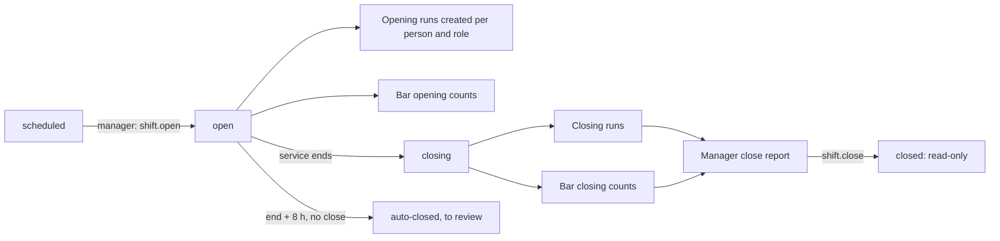
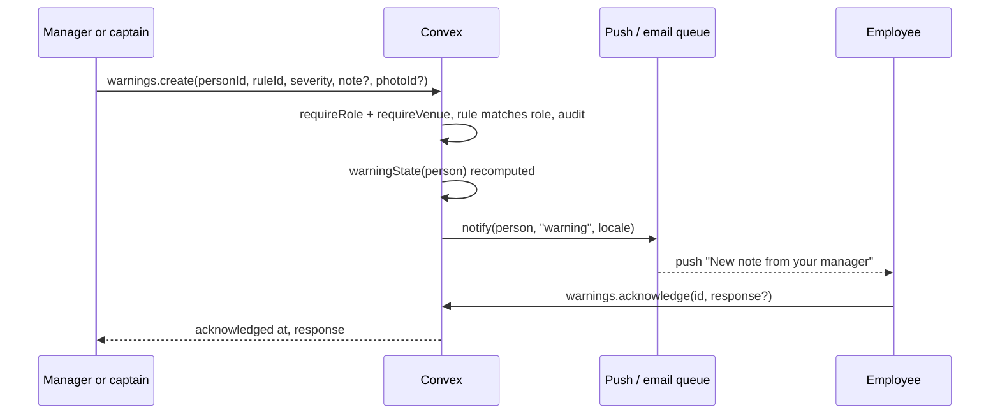
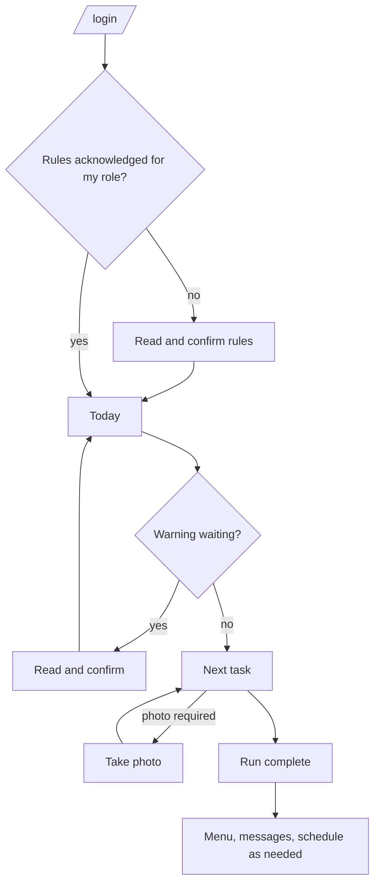
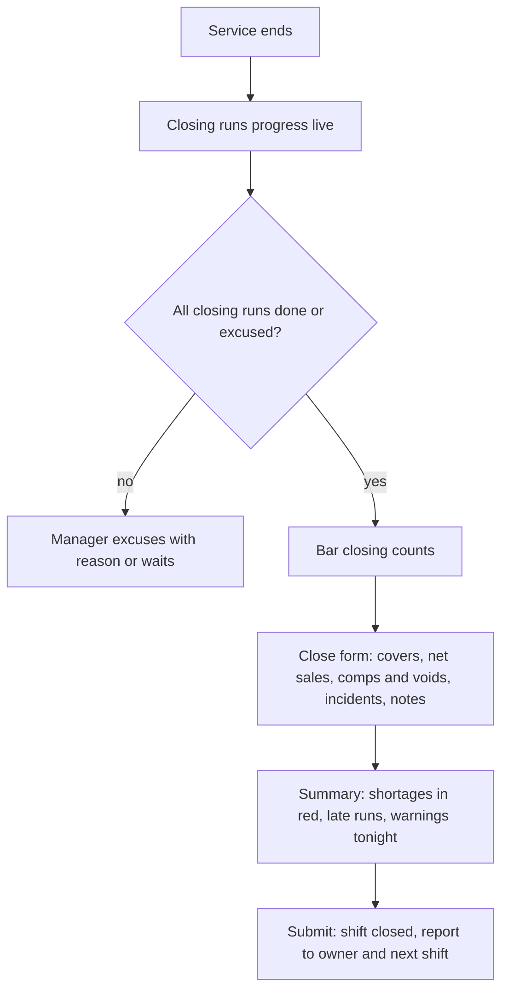
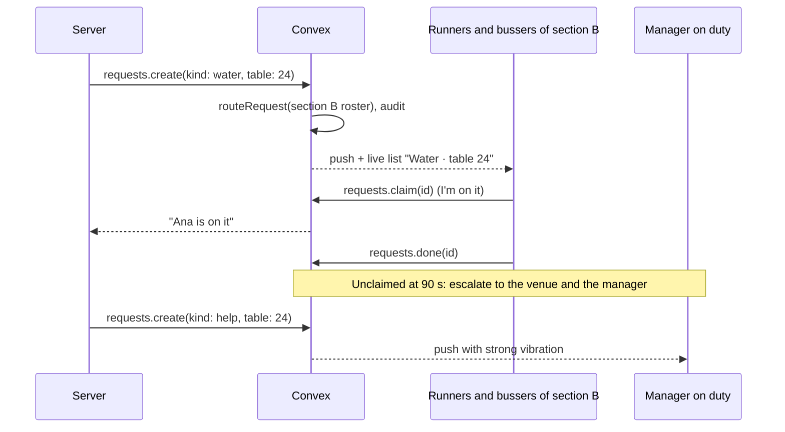
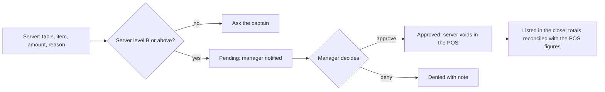
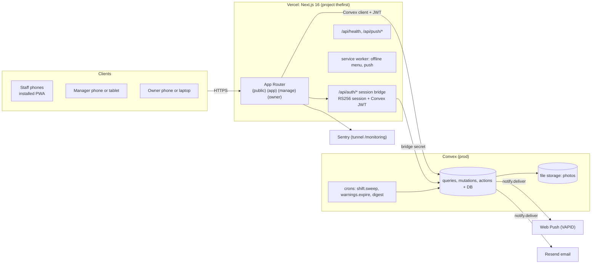
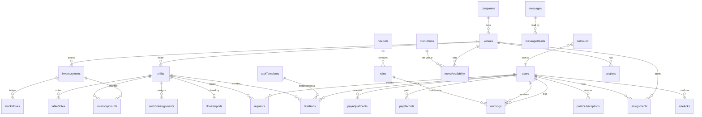
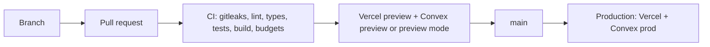
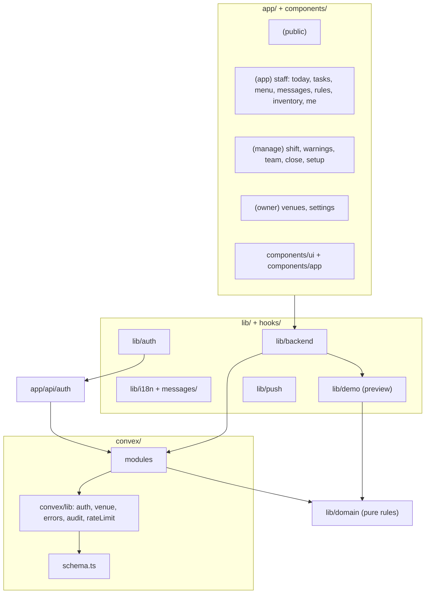

# BLUEPRINT: The First Hospitality Group

> Mandatory source of truth. No change to architecture, contracts, modules, signatures, infrastructure or quality thresholds is valid until it is reflected here, with a date. Decisions that are expensive to reverse are in `docs/adr/`.
> Created 2026-10-13 as a from-scratch build on the technical base of OSCURA NYC (blueprint of 2026-10-13, commit `3bdf7bf`). What was kept, adapted, replaced and added is in `docs/MIGRATION-FROM-OSCURA.md`.
> Conflict rule (ADR 0001): product and brand follow this blueprint; stack, code conventions and infrastructure follow the OSCURA base unless they contradict a requirement here. Every such conflict is an ADR.
> Language: the product is bilingual EN/ES (ADR 0004). Code and docs are in English; `EMPEZAR.md`, the commercial proposal and the market study are in Spanish for the owner side (ADR 0012).
> Anything marked `(to be validated)` is a starting point, not a closed decision.
> Updated 2026-10-13 (v1.1): floor requests and help, void and comp approvals, table notes, staff levels A/B/C, weekly recurring tasks, pay records and adjustments (ADR 0013 to 0017). See section 18.

---

## 1. Concept

**Company and product.** The First Hospitality Group (TFHG) runs four high-class restaurants in New York. The product is its staff operating system, an installable web app called **The First** `(to be validated)`.

**One-liner.** One system for every venue: everyone knows what to do, what we serve and how we work.

**Problem.** Four large venues run on memory, paper and group chats:
1. Staff have no menu information or photos of dishes and products.
2. Servers, bussers and runners do not know exactly their opening and closing tasks.
3. Bartenders and barbacks neither see nor document the inventory.
4. Schedules and event information are scattered.
5. House rules and mistakes leave no record.
6. Information does not reach everyone: there is no group channel the company controls.
7. Managers close the restaurant without a formal close report.
8. On the floor, asking for water, a table clear or a manager means walking or shouting; voids and comps are approved verbally and leave no trace.
9. Guest notes (allergies, VIPs, occasions) live in the server's head and do not reach the kitchen.
10. Weekly duties (Monday deep clean) depend on someone remembering.
11. Pay rates and bonuses are approved by chat with no record of who authorized them.

The owner learns about the cost (a comped table, a missing bottle, a guest with an allergy served wrong) after it happened.

**Thesis (sales line).** Protection → Organization → More money + Control.

**Owner's system map (from the sketch), covered:** company and language (EN/ES) · levels A/B/C · account and user routed to Kitchen or Floor · open and close · Floor: server, runner, busser with notes → information and quick actions (water, help, void, attend) · Bar: bartender, barback with inventory · Manager on the floor: schedule, warnings, rules · weekly routine (Monday clean) · notes and warnings per employee · salary with ON by manager or captain.

**Who it is for.**
| Actor | Who | What they need |
|---|---|---|
| Staff | Servers, runners, bussers, bartenders, barbacks, kitchen. High turnover, multilingual, phone in hand, ages 18 to 65 working, usability target 12 to 65 | Open the app and see what to do today, what we serve, the rules and the messages |
| Captain | Floor lead per section | Same as staff, plus log warnings and see their section's tasks |
| Manager | Runs the venue on a shift | Open and close the shift, see who is behind, log warnings, send messages, file the close report |
| Owner | TFHG ownership (up to 3 accounts `(to be validated)`) | The four venues on one screen: closes, shortages, team performance |

**Usability standard.** A 12-year-old understands every staff screen without explanation; a 65-year-old uses it without help. This is a usability target, not a hiring profile: accounts are for people of legal working age in New York, and serving or preparing alcohol requires the legal age (section 10).

**Positioning.** 7shifts organizes *when* people work; The First organizes *what they do and how*. It does not compete on scheduling (section 7, ADR 0011).

**Success metrics** (measured from the pilot venue, week 3 onward).
| Metric | Target | Source |
|---|---|---|
| Opening and closing checklists completed on time | ≥ 95 % of assigned runs | `taskRuns` |
| Shifts with a submitted close report | 100 % | `closeReports` |
| Messages read within 24 h by their audience | ≥ 90 % | `messageReads` |
| Time to log a warning (open form → sent) | p95 < 30 s | client timing event |
| New hire finds a dish's allergens | < 10 s from the home screen | moderated test, 5 people aged 18–65 |
| Bar shortage visible to the owner | same night, 100 % of closes with a counted difference | `closeReports.summary` |
| Usability | SUS ≥ 80 in the pilot, no group below 72 (by age band) | survey at day 14 |
| Help request answered (claimed) | p95 < 2 min in service | `requests` |
| Voids and comps with a recorded approval | 100 %; close totals match approved totals or the difference is flagged | `requests`, `closeReports` |
| Allergy table notes seen by the kitchen | 100 % acknowledged before the course fires | `tableNotes` |

**Out of scope (v1).** Payroll processing (paying people, taxes, pay stubs), tips, time clock and shift trading (7shifts or the POS do that), order taking and the voiding itself (done in the POS; The First records the request and the approval), online ordering, reservations, guest-facing anything, recipe costing for the kitchen, native store apps. Kitchen staff get messages, menu, tasks and the allergy board, not kitchen tickets. Pay records are a reference and approval log, never a deduction tool (ADR 0017).

---

## 2. Functional analysis

### 2.1 Actors and roles
Every account has exactly one role and one or more venue assignments (ADR 0003). The owner role is company-wide.

| Role | Code | Venues | Can |
|---|---|---|---|
| Server | `server` | assigned | Today, menu, own tasks, schedule, rules, messages, own warnings, acknowledge and answer a warning, floor requests, void and comp requests (level B+), table notes |
| Runner | `runner` | assigned | Same as server |
| Busser | `busser` | assigned | Today, own tasks, schedule, rules, messages, own warnings |
| Bartender | `bartender` | assigned | Server set + bar inventory counts and photos |
| Barback | `barback` | assigned | Bartender set |
| Kitchen | `kitchen` | assigned | Today, menu, messages, own tasks, rules, own warnings, allergy board (confirm allergy table notes), help requests |
| Captain | `captain` | assigned | Staff set for their venue + log warnings, see section task progress, assign sections, answer help, approve comps when the company allows, propose pay adjustments |
| Manager | `manager` | assigned | Everything in the venue: approve voids and comps, switch ON captains' pay proposals, set levels, open and close the shift, all tasks, team, warnings, messages to the venue, close report, menu availability, rules and task templates for the venue, staff accounts of the venue (no owner accounts) |
| Owner | `owner` | all | Everything, company-wide: the 4-venue dashboard, company menu and rules, thresholds, all accounts, audit log |
| Dev | `dev` | all | Every role plus a role switcher, preview and local only (as in OSCURA ADR 0016) |

**Floor actions by role** (v1.1):
| Action | Who can | Who receives or decides |
|---|---|---|
| Request water, table clear | server, runner, bartender, captain | runners and bussers on duty in that section |
| Request help | every staff role | captain and manager on duty (priority) |
| "I'm on it" (claim) and done | the receiving roles | the requester sees it live |
| Request a void or comp | server, bartender, captain | manager on duty approves or denies; captain too when the company setting allows `(to be validated)` |
| Table note (allergy, VIP, occasion, preference) | server, captain, manager | section staff; allergy notes also to kitchen |
| Assign sections for the shift | manager, captain | the assigned staff |
| Pay records and adjustments | see section 2.2 "Pay" | owner; manager or captain authorization (ADR 0017) |

**Staff levels A, B, C** (ADR 0014). Every staff account has a level besides its role. Proposed meaning `(to be validated)`: **C** in training, **B** trained, **A** lead. Levels decide which training checklist a person sees in the Guide, which task items are assigned to them (a template item can require level B or A), and which actions are open to them (a level C server cannot request a comp; level A can be named section lead). A manager sets the level; every change is audited. Alternative reading of the sketch, also supported by the data model: A/B/C as the person's English level for line-up and guest contact, set as a separate `languageLevel` field.

### 2.2 User stories with acceptance criteria
- **Sign in (ADR 0003).** One screen, `/login`, username + password (owner and manager may also use a verified email). Five wrong passwords lock the account 15 minutes. Every failure answers `INVALID_CREDENTIALS`. A manager creates a staff account with a temporary password; the person sets their own on first sign-in (`mustChangePassword`). A manager resets a staff password; the owner resets a manager's.
- **Today (staff home).** After sign-in I land on Today for my venue and the current shift: my next task, my checklist progress, unread messages, any warning waiting for my acknowledgment, and the shift notes from the manager. My section and its table notes. Nothing else. One primary button: the next thing to do; the Request button floats above the tab bar.
- **Menu with photos.** I search or browse by category; each item shows a 4:3 photo, name, description, ingredients, allergens as chips, price, and "not available today" when the manager turned it off. Text in my language; the other language one tap away. Works offline once loaded.
- **Opening and closing tasks.** When the manager opens the shift, every assigned person gets a checklist run for their role (opening phase). I tick items; items marked "photo required" ask for a photo before they tick. Progress is live for the manager. At close, the closing phase runs the same way. A run past its due time turns "late" for the manager, never red for me.
- **Messages.** A manager writes a message to the whole venue, one role, or (owner) all four venues, in EN and ES (machine draft of the second language allowed, human-reviewed `(to be validated)`). It arrives as a push notification and in the inbox. "Requires confirmation" messages show a button "I read it"; the sender sees who read and who did not.
- **Rules.** The house rules per role live in the app, versioned. When a rule set changes, each person must open it and confirm before their next checklist starts. Every warning points to one rule.
- **Warnings (ADR 0007).**
  1. Manager or captain taps "Log a warning": person, rule (searchable, filtered by the person's role), severity (minor or major), optional note and photo. Target: under 30 seconds.
  2. The person receives it by push and in the app, in their language: the rule, what happened, how to do it right.
  3. The person confirms they read it and may add a response (their side).
  4. The system recomputes the person's state: Up to date, Attention, Follow-up, Review (section 2.4).
  5. Every create, response, void and threshold change is audited. A manager can void a warning within 24 h with a reason; voided warnings never count.
- **Performance board.** Manager: per person (warnings in the window, most-missed rules, checklist on-time rate, messages read), per role, and recognition (longest run of shifts without a warning). Owner: the same per venue and across the four.
- **Bar inventory.** At shift open the bartender or barback counts each active item (bottles in tenths) and may add a photo; at close they count again. The system shows usage vs. the previous count and purchases, and flags shortages against the tolerance. Purchases are entered by the manager. Moves are append-only.
- **Manager close report (ADR 0008).** To close the shift the manager files: covers, net sales and comps/voids (typed from the POS end-of-day report), incidents (free text + optional photo), cleaning checklist status (auto from the closing runs), bar shortages (auto from counts), staff notes, and notes for the next shift. Submit locks the shift; the report is read-only and goes to the owner dashboard and the next shift's Today.
- **Owner dashboard.** Four venue cards: tonight's status (open, closed, close missing), last close figures, shortages, open "Review" states, checklist on-time rate this week. Tap a venue for detail. Nothing a staff account can open.
- **Schedule and events (P3).** A simple published schedule per venue (who works which shift) and an events calendar (private dinners, buyouts, tastings) with notes per role. If the company already uses 7shifts, the schedule is read from there (ADR 0011).
- **Settings for me.** Language (EN/ES), Large text, theme (system, light, dark), notifications on/off per type, change password, sign out everywhere.
- **Sections (Atiende).** At shift open the manager or captain assigns sections (for example B: tables 20 to 28) to servers, runners and bussers. My Today shows my section; requests from my section reach me first.
- **Floor requests and help (ADR 0013).** A floating **Request** button sits on every staff screen during an open shift. Two taps: what (Water, Clear table, Help, Void, Comp) and which table (my section's tables first). Water and Clear go to the runners and bussers of that section; Help goes to the captain and manager on duty with a strong vibration. A receiver taps **I'm on it**, then **Done**; the requester sees each step. Unclaimed after 90 s: the request escalates to the whole venue's role and to the manager. Target: delivered in under 3 s, help claimed p95 under 2 minutes.
- **Void and comp approvals (Anular).** The server picks the table, the item (from the menu or free text), the amount and a reason from a list (wrong item, quality, guest left, manager courtesy, other). The manager on duty gets it at once and taps Approve or Deny, with an optional note. The server then voids it in the POS. Every approval is audited and listed in the close; the close compares the approved total with the comps and voids typed from the POS and flags any difference.
- **Table notes (Notes → Information).** During the shift a server or captain adds a note to a table: allergy, VIP, occasion, preference or other, in a few words (no guest contact details). Section staff see it on the table; allergy notes also appear on the kitchen's allergy board and the kitchen confirms them. Notes archive when the shift closes and are deleted after 30 days.
- **Weekly recurring tasks (monday clean).** A task template runs every shift or on chosen weekdays and services: "Monday: deep clean of the bar fridges" appears in Monday's opening runs of the roles it targets, with its own due time. Templates can target a role, a section and a minimum level.
- **Pay (ADR 0017, P3).** The owner keeps each person's pay type (hourly or salaried) and rate with an effective date. Captains and managers can **propose** an adjustment (bonus, recognition award, correction); it takes effect only when **switched ON** by an authorized approver: a manager approves a captain's proposal, the owner approves a manager's. The employee sees their own rate and approved adjustments. A monthly CSV export goes to the payroll provider. No adjustment can reduce pay because of a warning or a mistake (NY wage-deduction rules, confirm with counsel).

### 2.3 House rules (seed, editable by the owner; one example set per role `(to be validated)`)
1. Confirm allergies and dietary notes with the kitchen before the first course.
2. Never serve alcohol to anyone who looks under 30 without checking ID; nobody under 21 is served.
3. Phones away on the floor except to use The First.
4. Uniform and grooming to the house standard at line-up.
5. Report a broken glass or spill immediately and mark the area.
6. Every comp or void is approved by the manager on duty.
7. Bottles leave the bar only with a count entry.
8. Closing tasks are done before clocking out.

### 2.4 Business rules
| Rule | Value | Where |
|---|---|---|
| Tenancy | One company, venues under it; every record carries `venueId` (or is company-wide) | ADR 0002, `requireVenue` |
| Roles | Exactly one per account; venue assignments are separate | `users.role`, `assignments` |
| Shift | One per venue per service (`lunch`, `dinner`, `late` `(to be validated)`), states `scheduled → open → closing → closed` | `shifts`, `lib/domain/shift.ts` |
| Open a shift | Manager only; creates the opening runs for everyone assigned and present | `shift.open` |
| Close a shift | Manager only; requires the close report; after it the shift's runs, counts and report are read-only | `shift.close`, ADR 0008 |
| Forgotten shift | Open past its end + 4 h: the manager and owner are notified; at end + 8 h the sweep closes it as `autoClosed`, "to review" | `shift.sweep` cron |
| Task due | Opening runs due at service start; closing runs due 60 min after service end `(to be validated)` | `taskTemplates.dueOffsetMin` |
| Warning window | Rolling 30 days | `WARNING_WINDOW_DAYS` |
| Warning states | Up to date: 0. Attention: 1–2 minor. Follow-up: 3+ minor or 1 major. Review: 2+ major. Thresholds configurable per company | `warningState()` |
| Warning without a rule | Not allowed | `warnings.create` (`RULE_REQUIRED`) |
| Void | Within 24 h, manager or owner, reason required; voided never count | `warnings.void` |
| Visibility | Staff see only their own warnings; captains see their venue's but cannot void; money and close figures are manager and owner only | `lib/domain/permissions.ts` |
| Rules version | Changing a role's rule set bumps its version; a person must acknowledge before their next run starts | `ruleSets.version`, `ruleAcks` |
| Inventory counts | Bottles in tenths (0.1); tolerance 0.25 bottle per item per shift (from OSCURA ADR 0014) | `stock.ts` |
| Money | Integer cents, typed by the manager from the POS; never computed from guest data | `closeReports.*Cents` |
| Time | Every shift and due-time calculation in `America/New_York` | `lib/time.ts` |
| Menu | Company catalog; each venue sets availability and price override `(to be validated)` | `menuItems`, `menuAvailability` |
| Requests | Kinds `water`, `clear`, `help`, `void`, `comp`; states `open → claimed → done` or `canceled`; void and comp `pending → approved \| denied` | `lib/domain/requests.ts` |
| Request routing | Water and clear to runners and bussers of the section, then the venue at 90 s; help to captain and manager on duty | `routeRequest()` |
| Void and comp approval | Manager on duty; captain only when `company.captainApprovesComps` is on; nobody approves their own request | `requests.decide` |
| Close reconciliation | Comps and voids typed from the POS vs. approved totals; difference over USD 1 flagged | `closeSummary()` |
| Table notes | Free text ≤ 140 characters, kinds allergy, vip, occasion, preference, other; archived at close, deleted after 30 days | `tableNotes` |
| Levels | `A`, `B`, `C` per staff account; gates comp requests (B+), section lead (A), task items with `minLevel` | `lib/domain/levels.ts` |
| Recurring tasks | Template schedule `every_shift` or `weekly` with weekdays and services | `appliesOn()` |
| Pay | Rates owner-only; adjustments need an approver above the proposer; no negative adjustments linked to warnings | `lib/domain/pay.ts`, ADR 0017 |

---

## 3. Flows

### 3.1 Shift lifecycle

### 3.2 Logging a warning

### 3.3 Staff day

### 3.4 Manager close

### 3.5 Floor request and help

### 3.6 Void or comp approval

---

## 4. Experience, brand and art direction

### 4.1 Branding and tokens
Brand system in `docs/brand/` (BRAND.md, tokens.css, brand.json, logos, brand-board.png). Summary:
- **Design read:** operational mobile app for hospitality staff of all ages, with an executive, calm, trust-first language; restrained like a well-run dining room. Dials: variance 3, motion 3, density 4.
- **Color:** white primary, ink `#111311` secondary, olive `#5C6B2F` as the single brand color (primary action, active tab, progress). Status colors are separate and carry meaning only (ok, info, attention, follow-up, review). All text pairs AA, control borders 3:1.
- **Type:** Figtree for everything (body 17, inputs 17, never under 16), IBM Plex Mono for codes and quantities. Large text setting × 1.18.
- **Logo:** TFHG monogram, TF over HG in Figtree Bold with optical gaps; wordmark THE FIRST.
- **Shape:** one soft radius scale (6/10/12/16/24), 48 px minimum targets, 56 px for primary actions and checklist rows.

### 4.2 Design system (`components/ui/`, composed, never restyled; ADR 0009)
Kept from OSCURA and re-tokened: `Button` (primary olive, secondary ink outline, quiet text, destructive two-tap `ConfirmButton`), `Field` family, `ChoiceCard`/`ChoicePill`, `Tabs`, `Sheet` (vaul), `Skeleton`/`EmptyState`/`ErrorState`/`OfflineNote`/`InlineError`, `MoneyText`.
New:
- `ChecklistRow` (56 px, check fills olive with a 120 ms tick, photo badge, late badge for managers)
- `ProgressBar` (olive on olive-100)
- `MenuCard` and `MenuDetail` (4:3 photo, allergen chips in review colors, availability state)
- `StatusChip` (ok, info, attention, follow-up, review; icon + word, never color alone)
- `WarningCard` (rule, what happened, how to do it right, acknowledge, response)
- `MessageCard` (audience, read receipt, requires-confirmation button)
- `CountStepper` (bottles in tenths, big +/− targets, long-press to repeat)
- `VenueCard` (owner dashboard), `KpiRow` (label + mono figure)
- `PhotoField` (camera or library, compressed client-side to ≤ 400 KB)
- `BottomNav` (4 tabs max per role), `TFHGMark`, `Wordmark`
- `RequestButton` (floating, 56 px, olive) and `RequestSheet` (kind grid with large icons, table picker with my section first)
- `RequestQueue` (live list with I'm on it and Done), `ApprovalCard` (void or comp with Approve and Deny)
- `SectionCard` (my section and tables), `TableNoteChip` (kind icon + word; allergy uses the review color), `AllergyBoard` (kitchen)
- `LevelBadge` (A, B, C), `PayRecordRow`, `AdjustmentCard` (proposed, ON by approver, exported)

### 4.3 Voice and microcopy
Plain and short, second person, verbs first ("Fold napkins for 40 covers"). Warnings name the rule and how to do it right; never shaming words. Spanish is neutral with "tú". No emojis, no em dashes in the UI. Every string in `messages/en.json` and `messages/es.json` with identical keys.

### 4.4 Motion
No premium motion layer: this is an operational tool (section 4.4 of the template does not apply). Motion is press feedback (120 ms), sheets (320 ms), the check fill and the progress bar; CSS keyframes on the duration tokens; `prefers-reduced-motion` removes them. Mobile-native baseline from OSCURA applies: `viewport-fit=cover`, `100dvh` shells, 16 px+ inputs, hover only under `(hover:hover) and (pointer:fine)`, `touch-action: manipulation`, no tap highlight, `theme-color` per scheme, wake lock on counting screens.

---

## 5. Architecture

### 5.1 Style
Modular monolith, as OSCURA: one Next.js app and one Convex deployment, with modules separated by folder and enforced by the role and venue guards. Four venues and a few hundred staff do not justify services; Convex gives reactivity (live checklist progress) and transactions (counts, closes) out of the box.

### 5.2 Context and containers

### 5.3 Stack (pinned at Sprint 0 to the versions OSCURA ships, then updated in one PR)
| Layer | Choice | Version (OSCURA base) |
|---|---|---|
| Web | Next.js App Router, `cacheComponents` | 16.4 |
| UI | React, Tailwind v4, Phosphor icons, `sonner`, `vaul`, `motion` (only if a spring is needed) | 19.3 / 4 |
| Language | TypeScript strict | 5.x |
| Backend | Convex + `convex-helpers` | 1.46 |
| Auth | Own session bridge (username + password, PBKDF2, RS256 cookie, Convex `customJwt`) | from OSCURA ADR 0016/0021/0024 |
| Validation | Zod schemas in `schemas/` shared by client and Convex | 3.x |
| Push | `web-push` (VAPID) from a Convex action | 3.x |
| Email | Resend through the outbound queue | - |
| Monitoring | Sentry `@sentry/nextjs` with scrubbing | - |
| Tests | Vitest, convex-test, Playwright + axe, Lighthouse CI | - |
| Hosting | Vercel (web), Convex Cloud (backend) | - |

### 5.4 Communication
- Client ↔ Convex: reactive queries and mutations over WebSocket with the Convex JWT.
- Sign-in, password and session: Next.js route handlers → Convex bridge mutations with `AUTH_BRIDGE_SECRET`.
- Photos: `files.generateUploadUrl` → direct upload to Convex storage → `files.attach` stores the id; reads go through queries that check access and return a short-lived URL.
- Notifications: mutations enqueue `outbound` rows in the same transaction; `notify.deliver` (action) sends push, falls back to email, retries 3 times with backoff.

---

## 6. Frontend

### 6.1 Routes
Route groups (as OSCURA 2026-10-13): `(public)`, `(app)` staff, `(manage)` manager and captain, `(owner)`. Each group has `loading.tsx` and `error.tsx`.

| Route | Who | Content | Render |
|---|---|---|---|
| `/` | Public | Brand page with "Sign in" and "Install the app"; signed-in users go to `/today` | Static |
| `/login` | All | Username or email + password; first sign-in sets a new password | Dynamic |
| `/today` | Staff, captain, manager | Role-based home (section 2.2) | Client, reactive |
| `/tasks` | Staff+ | My current run; `?phase=open|close` | Client |
| `/menu`, `/menu/[itemId]` | Staff+ | Search, categories, detail with photo and allergens | Client with offline cache |
| `/messages`, `/messages/[id]` | Staff+ | Inbox, detail, "I read it" | Client |
| `/rules` | Staff+ | My role's rules, confirm new version | Client |
| `/schedule` | Staff+ | My shifts and venue events (P3) | Client |
| `/inventory` | Bartender, barback, manager | Count screen (opening or closing), item photo, history of tonight | Client, wake lock |
| `/me` | All | My warnings and state, language, Large text, theme, notifications, password, sign out everywhere | Client |
| `/manage` | Manager, captain | Shift control: open, live progress by person, late runs, warnings tonight | Client |
| `/manage/warnings`, `/manage/warnings/new` | Manager, captain | List and the 30-second form | Client |
| `/manage/team`, `/manage/team/[userId]` | Manager | Performance per person and role | Client |
| `/manage/messages/new` | Manager | Compose EN/ES, audience, requires confirmation | Client |
| `/manage/close` | Manager | Close form and summary (section 2.2) | Client |
| `/manage/setup/{menu,tasks,rules,inventory,staff}` | Manager (venue), owner (company) | Catalog with photos, task templates per role and phase, rule sets, inventory items and purchases, staff accounts | Client |
| `/floor` | Server, runner, busser, bartender, captain | My section and tables, table notes, open requests for me | Client, reactive |
| `/kitchen` | Kitchen | Allergy board for tonight, messages | Client, reactive |
| `/manage/requests` | Manager, captain | Live queue, approvals for voids and comps, escalations | Client, reactive |
| `/manage/sections` | Manager, captain | Assign sections for the shift | Client |
| `/manage/pay` | Manager, captain | Propose adjustments; manager switches ON captains' proposals (P3) | Client |
| `/owner` | Owner | Four venue cards | Client |
| `/owner/pay` | Owner | Pay records, adjustments to approve, monthly export (P3) | Client |
| `/owner/venues/[venueId]` | Owner | Venue detail: closes, shortages, performance | Client |
| `/owner/settings` | Owner | Company, venues, warning thresholds, owner accounts, audit log | Client |
| `/guide` | All | Short how-to per screen and role, with a help button on every screen | Static per locale |
| `/legal/[doc]` | Public | `terms`, `privacy` (internal staff notice) | Static |

### 6.2 Render and caching
Staff routes are client-rendered shells (`(app)` layout with `RequireAuth`), data from Convex queries. Static: `/`, `/guide`, `/legal/*`. The service worker caches the app shell, `/menu` data snapshot and menu photos (stale-while-revalidate, 50 MB cap) for offline use on the floor.

### 6.3 State and data
`lib/backend/hooks.ts` (`useQuery`, `useMutation`) as in OSCURA: Convex when `NEXT_PUBLIC_CONVEX_URL` is set, preview handlers in `lib/demo/` otherwise (ADR 0010). Current venue and shift come from `useCurrentShift()`; no ids in staff URLs. User preferences (locale, large text, theme) in the user record, mirrored in a cookie for the first paint.

### 6.4 Forms and validation
Zod schemas in `schemas/` imported by both the client and Convex validators. Label above input, error below, no placeholder-as-label. Photo fields compress to ≤ 400 KB JPEG (longest side 1600 px) before upload.

### 6.5 Accessibility
WCAG 2.2 AA: semantic landmarks, visible focus (blue ring), labels on every control, status never by color alone (chip = icon + word), 48 px targets, Large text setting, `prefers-reduced-motion`, screen-reader announcements on check and submit. Tested in EN and ES.

### 6.6 Performance budgets
| Budget | Threshold |
|---|---|
| Route JS (gzip) | ≤ 170 KB on `/today`, `/tasks`, `/menu`, `/floor`, `/kitchen`; ≤ 220 KB on `/manage/*` and `/owner/*` |
| First load on 4G (Moto G Power class) | LCP < 2.5 s, INP < 200 ms, CLS < 0.1 |
| Menu photo | ≤ 120 KB per list thumbnail (Next Image, AVIF/WebP), ≤ 400 KB detail |
| Fonts | Figtree 400/600/700 + Plex Mono 400, subset latin + latin-ext, `display=swap` |

### 6.7 i18n, metadata
`messages/en.json` and `messages/es.json`, identical keys, `useT()`; content fields (menu, rules, tasks, messages) stored as `{ en, es }` with `pickLocalized()`. English default for new accounts, user choice persisted. PWA manifest localized per request. `robots`: noindex everywhere except `/`.

### 6.8 Product analytics
Self-hosted events in Convex (`events` table `(to be validated)`): `task_checked`, `run_completed`, `warning_logged` (with form duration), `message_read`, `menu_item_viewed`, `close_submitted`. No third-party trackers.

### 6.9 States
Every data screen: skeleton, empty (with what to do), error (with retry), offline (cached data + banner), locked (shift not open, rules to confirm).

---

## 7. Backend: functions and contracts (Convex)

### 7.1 Domain boundaries
`org` (company, venues, assignments) · `auth` · `staff` · `menu` · `tasks` · `shifts` · `close` · `inventory` · `rules` · `warnings` · `messages` · `notify` · `schedule` · `reports` · `files` · `audit` · `seed`.

### 7.2 Contracts
Every input validated with Convex validators plus Zod; every mutation calls `requireRole(ctx, roles)` and `requireVenue(ctx, venueId)`; errors are `ConvexError({ code, message, details? })`.

| Module | Function | Kind | Access | Contract |
|---|---|---|---|---|
| auth | signIn | mutation | bridge secret | `{login, password, secret}` → `{ok, subject?, mustChangePassword?, error?: INVALID_CREDENTIALS\|ACCOUNT_LOCKED}` |
| auth | changePassword, revokeSessions | mutation | bridge secret | as OSCURA; ends other sessions |
| auth | requestCode, verifyCode | mutation | public / bridge | Email recovery for manager and owner only |
| auth | me | query | user | `{id, name, role, venues[{id, name}], locale, largeText, theme, isOwner, isDev, mustChangePassword}` |
| org | venues, setVenue | q/m | owner | Company venues (name, slug, timezone, services[]) |
| staff | list, upsert, assign, resetPassword, deactivate | q/m | manager (own venue, no managers/owners), owner (all) | `upsert {userId?, name, username, role, venueIds[], locale}` → `{userId, tempPassword?}` |
| me | updatePrefs | mutation | user | `{locale?, largeText?, theme?, notify?{messages, warnings, tasks}}` |
| menu | list | query | staff+ | `{venueId, category?, q?}` → items with `photoUrl`, availability, allergens |
| menu | get | query | staff+ | `{itemId, venueId}` → full item |
| menu | upsert, setAvailability, reorder | mutation | owner (catalog), manager (availability, price override) | `upsert {itemId?, name{en,es}, description{en,es}, ingredients{en,es}, allergens[], category, priceCents, photoId?, tags[]}` |
| tasks | templates, upsertTemplate, removeTemplate | q/m | manager (venue), owner | `{templateId?, venueId, role, phase: open\|mid\|close, items[{label{en,es}, photoRequired, critical}], dueOffsetMin}` |
| tasks | myRun | query | staff+ | `{shiftId?}` → current run with items and progress |
| tasks | check | mutation | run owner | `{runId, itemIndex, done, photoId?}`; `PHOTO_REQUIRED`, `SHIFT_NOT_OPEN`, `RULES_NOT_ACKNOWLEDGED` |
| tasks | excuse | mutation | manager | `{runId, reason}` |
| tasks | shiftProgress | query | captain, manager | `{shiftId}` → per person: done/total, late, phase |
| shifts | current | query | staff+ | `{venueId}` → open or next shift |
| shifts | open | mutation | manager | `{venueId, service, date}` → `{shiftId}`; creates opening runs; `OTHER_SHIFT_OPEN`, `NOT_SCHEDULED` |
| shifts | startClosing | mutation | manager | `{shiftId}` → creates closing runs |
| shifts | sweep | internal mutation | cron (hourly) | Notifies at end + 4 h, auto-closes at end + 8 h |
| close | draft, save | q/m | manager | `{shiftId}` → prefilled draft (auto parts); `save {shiftId, coversCount, netSalesCents, compsCents, voidsCents, incidents[{text, photoId?}], staffNotes, nextShiftNotes}` |
| close | submit | mutation | manager | `{shiftId}` → `{summary}`; `MISSING_COUNTS`, `RUNS_OPEN` (unless excused), `INVALID_TRANSITION` |
| close | get, list | query | manager (venue), owner | Read-only reports |
| inventory | items, upsertItem | q/m | manager, owner | `{itemId?, venueId, name, category, unit: bottle\|unit, parLevel?, photoId?, active}` |
| inventory | count | mutation | bartender, barback, manager | `{shiftId, phase: open\|close, counts[{itemId, qty}], photoIds?[]}`; qty in tenths; `SHIFT_NOT_OPEN` |
| inventory | recordPurchase, recordMove | mutation | manager | Purchases with cost; waste, comp, transfer between venues, adjustment with reason (append-only) |
| inventory | shiftReport | query | manager, owner | `{shiftId}` → per item: opening, purchases, closing, used, difference, shortage flag |
| rules | forRole, sets, upsertSet | q/m | staff+ / manager, owner | `upsertSet {venueId?, role, rules[{id?, title{en,es}, body{en,es}, howTo{en,es}}]}` → new `version` |
| rules | acknowledge | mutation | staff+ | `{setId, version}` |
| warnings | create | mutation | captain, manager | `{venueId, userId, ruleId, severity: minor\|major, note?, photoId?}` → `{warningId, state}`; `RULE_REQUIRED`, `RULE_NOT_FOR_ROLE`, `FORBIDDEN` (self) |
| warnings | acknowledge | mutation | the warned person | `{warningId, response?}` (response ≤ 500 chars) |
| warnings | void | mutation | manager, owner | `{warningId, reason}` within 24 h; `TOO_LATE` |
| warnings | mine | query | staff+ | own warnings in window + state |
| warnings | forVenue, forUser | query | captain (read), manager, owner | Filters: person, rule, severity, date |
| warnings | thresholds, setThresholds | q/m | owner | `{attentionMinor, followUpMinor, followUpMajor, reviewMajor, windowDays}` |
| reports | team | query | manager, owner | `{venueId, from, to}` → per person: warnings, state, on-time rate, read rate, streak |
| reports | owner | query | owner | Four venue cards (section 2.2) |
| messages | send | mutation | manager (venue), owner (any) | `{audience: {venueIds[], roles[]?}, title{en,es}, body{en,es}, requiresConfirmation, photoId?}` → `{messageId, recipients}` |
| messages | inbox, get, markRead, confirm | q/m | staff+ | Own messages; read receipts |
| messages | receipts | query | sender, manager, owner | Who read, who confirmed |
| notify | subscribe, unsubscribe | mutation | user | Web push subscription per device |
| notify | deliver | internal action | queue | Push first, email fallback for manager/owner, 3 attempts with backoff |
| schedule | week, publish, events, upsertEvent | q/m | staff+ (read), manager | P3 (ADR 0011) |
| files | generateUploadUrl, attach, url | m/q | user | Upload ≤ 5 MB images only (`image/jpeg\|png\|webp\|heic`); `url` checks access |
| audit | list | query | owner | Filter by actor, entity, date |
| seed | bootstrap, demo | internal mutation | CLI | Company, 4 venues, owner account, rules, sample menu and task templates |
| floor | sections, upsertSection | q/m | staff+ / manager | `{sectionId?, venueId, name, tables[]}` |
| floor | assignSections | mutation | manager, captain | `{shiftId, assignments[{sectionId, userIds[]}]}` |
| floor | mySection | query | staff+ | `{shiftId}` → section, tables, notes, open requests for me |
| requests | create | mutation | staff+ (kind rules in 2.1) | `{shiftId, kind, table?, item?, amountCents?, reason?, note?}` → `{requestId, recipients}`; `SHIFT_NOT_OPEN`, `LEVEL_FORBIDDEN`, `RATE_LIMITED` |
| requests | claim, done, cancel | mutation | recipient / requester | `{requestId}`; `REQUEST_CLOSED` when already claimed or closed |
| requests | decide | mutation | manager (captain if enabled) | `{requestId, decision: approve\|deny, note?}`; `SELF_APPROVAL`, `REQUEST_CLOSED` |
| requests | open, mine, forShift | query | staff+ / manager, owner | Live queues; `forShift` feeds the close |
| requests | escalate | internal mutation | scheduler (90 s after create) | Widens recipients if still open |
| tableNotes | add, archive, confirm | mutation | server, captain, manager / kitchen (confirm) | `{shiftId, table, kind, text}` (≤ 140 chars) |
| tableNotes | forShift, allergyBoard | query | section staff, kitchen, manager | Tonight's notes |
| staff | setLevel | mutation | manager, owner | `{userId, level: A\|B\|C, languageLevel?}`; audited |
| tasks | upsertTemplate (v1.1) | mutation | manager, owner | adds `schedule {kind: every_shift\|weekly, weekdays?[], services?[]}`, items `{minLevel?, sectionId?}` |
| pay | records, setRate | q/m | owner | `{userId, type: hourly\|salaried, rateCents, effectiveFrom}` |
| pay | propose | mutation | captain, manager | `{userId, kind: bonus\|award\|correction, amountCents (> 0, or a correction tied to a rate error), reason}`; `NO_DEDUCTIONS` |
| pay | switchOn, reject | mutation | approver above the proposer (manager for captain, owner for manager) | `{adjustmentId, note?}`; `SELF_APPROVAL`, `PAY_FORBIDDEN` |
| pay | mine, exportMonth | q/m | staff / owner | Own rate and approved adjustments; CSV for payroll, audited |

**Error codes** (`convex/lib/errors.ts`): `UNAUTHENTICATED`, `FORBIDDEN`, `NOT_FOUND`, `INVALID_INPUT`, `RATE_LIMITED`, `INVALID_CREDENTIALS`, `ACCOUNT_LOCKED`, `INVALID_CODE`, `CODE_EXPIRED`, `VENUE_FORBIDDEN`, `SHIFT_NOT_OPEN`, `OTHER_SHIFT_OPEN`, `NOT_SCHEDULED`, `INVALID_TRANSITION`, `RUNS_OPEN`, `MISSING_COUNTS`, `PHOTO_REQUIRED`, `RULES_NOT_ACKNOWLEDGED`, `RULE_REQUIRED`, `RULE_NOT_FOR_ROLE`, `TOO_LATE`, `FILE_TOO_LARGE`, `FILE_TYPE`, `NO_RECIPIENTS`, `REQUEST_CLOSED`, `SELF_APPROVAL`, `LEVEL_FORBIDDEN`, `PAY_FORBIDDEN`, `NO_DEDUCTIONS`.

### 7.3 Authentication and authorization
- Session bridge from OSCURA (ADR 0003): RS256 httpOnly session cookie, Convex `customJwt`, JWKS at `/api/auth/session/jwks`, session versions to sign out everywhere.
- `requireRole(ctx, allowed)` and `requireVenue(ctx, venueId)` in every function; owner passes every venue check; dev only outside production.
- Permission matrix in `lib/domain/permissions.ts` (`can(role, action)`), shared with the UI to hide what a role cannot do. The server is the authority.

### 7.4 Errors
One shape, `toClientError()` on the client, messages translated by code (`errors.<CODE>`). Bridge mutations return `{ok:false, error}` instead of throwing.

### 7.5 Async and cron
| Job | Schedule | Does |
|---|---|---|
| `shift.sweep` | hourly :05 UTC | Notify forgotten shifts at end + 4 h; auto-close at end + 8 h with counts and drafts, marked to review |
| `tasks.lateCheck` | every 15 min | Marks runs late; notifies the manager once per shift with the list |
| `warnings.digest` | daily 10:00 NY | Owner digest: new Review states, unacknowledged warnings older than 48 h |
| `notify.deliver` | on enqueue | Push, fallback email, retries |
| `files.gc` | daily | Deletes uploads never attached after 24 h |
| `requests.escalate` | scheduled 90 s after each request | Widens recipients of unclaimed water, clear and help requests |
| `tableNotes.purge` | daily | Deletes archived table notes older than 30 days |

### 7.6 Integrations
- **Web Push** (VAPID keys in Convex env). iOS needs the PWA installed (iOS 16.4+); the app asks to install before asking for notification permission. Expired subscriptions (404/410) are removed.
- **Resend** for email fallback and manager/owner recovery codes.
- **POS** (Toast or the venues' POS) `(to be validated)`: v1 has no integration; the manager types figures from the end-of-day report. A read-only import of net sales and covers is a P3 candidate (ADR 0011).
- **7shifts** `(to be validated)`: if the company keeps it for scheduling, P3 reads the published schedule through its API instead of rebuilding scheduling.

### 7.7 Payments
Not applicable: The First never moves money. Close figures are typed records for control.

### 7.8 Rate limits and abuse
Fixed window in `rateLimits` (OSCURA `convex/lib/rateLimit.ts`):
| Key | Limit |
|---|---|
| `signin:<login>` | 10 / 10 min, lockout 5 failures → 15 min |
| `code:<email>` | 3 / 10 min |
| `pwchange:<userId>` | 5 / 10 min |
| `warn:<actorId>` | 30 / hour |
| `msg:<actorId>` | 20 / hour |
| `upload:<userId>` | 60 / hour |
| `req:<userId>` | 40 / hour (help is never limited) |
| `pay:<actorId>` | 20 / hour |

---

## 8. Data

### 8.1 Model

| Group | Table | Key fields | Indexes |
|---|---|---|---|
| Org | companies | name, slug, timezone, warningThresholds, createdAt | by_slug |
| Org | venues | companyId, name, slug, address?, services[{key, startsAt, endsAt}], active | by_company |
| Auth | users | username, email?, emailVerifiedAt?, name, role, level (A\|B\|C), languageLevel?, active, passwordHash, mustChangePassword, failedLogins, lockedUntil?, sessionVersion, locale, largeText, theme, notifyPrefs, isDev?, createdAt | by_username, by_email |
| Auth | assignments | userId, venueId, since | by_user, by_venue |
| Auth | authTokens, loginCodes | as OSCURA | as OSCURA |
| Menu | menuItems | companyId, name{en,es}, description{en,es}, ingredients{en,es}, allergens[], category, priceCents, photoId?, tags[], sort, active | by_company_category |
| Menu | menuAvailability | itemId, venueId, available, priceOverrideCents?, updatedBy, updatedAt | by_venue_item |
| Tasks | taskTemplates | venueId, role, phase, schedule{kind, weekdays?, services?}, items[{label{en,es}, photoRequired, critical, minLevel?, sectionId?}], dueOffsetMin, version, active | by_venue_role_phase |
| Tasks | taskRuns | shiftId, venueId, userId, templateId, templateVersion, phase, items[{done, at?, photoId?}], dueAt, completedAt?, late, excused?{by, reason} | by_shift, by_user_shift, by_venue_due |
| Shifts | shifts | venueId, date (NY), service, status, openedBy?, openedAt?, closingAt?, closedAt?, autoClosedAt?, reviewedAt? | by_venue_date, by_status |
| Close | closeReports | shiftId, venueId, coversCount, netSalesCents, compsCents, voidsCents, incidents[], staffNotes, nextShiftNotes, summary, status (draft\|submitted\|auto), submittedBy?, submittedAt? | by_shift, by_venue_submitted |
| Stock | inventoryItems | venueId, name, category, unit, parLevel?, photoId?, avgCostCents?, active, sort | by_venue_sort |
| Stock | inventoryCounts | shiftId, itemId, phase, qtyTenths, by, at, photoId? | by_shift, by_item |
| Stock | stockMoves | itemId, venueId, qtyTenths (signed), type (purchase\|count_adjust\|waste\|comp\|transfer_in\|transfer_out\|adjustment), unitCostCents?, shiftId?, note?, by, at. Append-only | by_item_at, by_shift |
| Rules | ruleSets | companyId, venueId?, role, version, publishedAt, publishedBy | by_role_venue |
| Rules | rules | setId, key, title{en,es}, body{en,es}, howTo{en,es}, sort | by_set |
| Rules | ruleAcks | userId, setId, version, at | by_user_set |
| Warnings | warnings | venueId, userId, ruleId, ruleVersion, severity, note?, photoId?, loggedBy, at, acknowledgedAt?, response?, voidedAt?, voidedBy?, voidReason? | by_user_at, by_venue_at, by_rule |
| Messages | messages | companyId, audience{venueIds[], roles[]}, title{en,es}, body{en,es}, requiresConfirmation, photoId?, sentBy, at, recipients | by_company_at |
| Messages | messageReads | messageId, userId, readAt?, confirmedAt? | by_message, by_user |
| Schedule | scheduleEntries, events | P3 | P3 |
| Floor | sections | venueId, name, tables[], sort | by_venue |
| Floor | sectionAssignments | shiftId, sectionId, userIds[], by, at | by_shift |
| Floor | requests | venueId, shiftId, kind, table?, sectionId?, createdBy, status, recipients[], claimedBy?, claimedAt?, doneAt?, escalatedAt?, item?, amountCents?, reason?, note?, decision?, decidedBy?, decidedAt?, decisionNote?, at | by_shift_status, by_venue_at, by_creator |
| Floor | tableNotes | venueId, shiftId, table, kind, text, by, at, kitchenConfirmedAt?, archivedAt? | by_shift, by_shift_kind |
| Pay | payRecords | userId, type, rateCents, effectiveFrom, by, at | by_user_from |
| Pay | payAdjustments | userId, kind, amountCents, reason, proposedBy, status (proposed\|on\|rejected\|exported), approvedBy?, approvedAt?, exportedAt?, at | by_user, by_status |
| Platform | pushSubscriptions | userId, endpoint, keys, ua, createdAt, lastOkAt? | by_user, by_endpoint |
| Platform | outbound | kind (push\|email), userId?, to?, payload, status, attempts, providerId?, createdAt | by_status_created |
| Platform | files | storageId, ownerId, purpose, attachedTo?, createdAt | by_owner, by_unattached |
| Platform | auditLogs, rateLimits, counters | as OSCURA | as OSCURA |

### 8.2 Critical queries
`tasks.shiftProgress` (by_shift), `warnings.mine` (by_user_at, window filter), `reports.owner` (by_venue_submitted, last 7 days), `menu.list` (by_company_category + by_venue_item). All bounded by venue and date; no unbounded scans.

### 8.3 Migrations and seeds
Convex schema changes are additive first; data rewrites through versioned internal mutations in `convex/migrations/` with a dry-run flag and a recorded run in `auditLogs`. `seed:bootstrap` creates the company, venues, owner account and the rule seed; `seed:demo` fills realistic sample data for preview.

### 8.4 Personal data
Staff name, username, optional email, language and display preferences, push endpoints, the work records (task completions, counts, warnings with responses). No date of birth, ID numbers, home address or phone in v1. Pay records (rate and adjustments) are the most sensitive data in the system: owner-only by default, visible to the person themselves, and to managers only for proposals they made; exported files are audited. Table notes carry no guest contact details and are deleted 30 days after the shift. Basis: employment operations. Warnings count for 30 days and are kept for 3 years as employment records `(to be validated with NY counsel)`. Deactivating an account keeps its records attributed by name; a deletion request anonymizes the user after the retention period. Staff see everything stored about their warnings in `/me`.

### 8.5 Backups
Convex scheduled export daily (retention 30 days) to a private bucket `(to be validated)`; restore drill before go-live and quarterly, written in `docs/runbooks/deploy-and-rollback.md`. RPO 24 h, RTO 4 h. Photos are included in the export.

---

## 9. DevOps and infrastructure

### 9.1 Repository
One repo `the-first` (Next.js app + `convex/`), created fresh. Code that comes from OSCURA is copied module by module with its tests, never by forking the OSCURA repo (ADR 0001). Agent tooling as OSCURA: `graphify` knowledge graph (local, ignored), vendored Convex skills.

### 9.2 Environments

| Env | Web | Backend | Data |
|---|---|---|---|
| Local | `next dev` | preview mode (no Convex) or `convex dev` | demo seed |
| Preview | Vercel per PR | preview mode by default; Convex preview deployment when the PR touches `convex/` | demo seed |
| Production | Vercel `thefirst` `(to be validated)` | Convex prod | real |

### 9.3 CI/CD
`.github/workflows/ci.yml`: `quality` (gitleaks, lint, typecheck, vitest with coverage, build, JS budgets, `npm audit --audit-level=high --omit=dev`), `convex` (codegen + typecheck, deploy on `main` with `CONVEX_DEPLOY_KEY`), `e2e` on PRs (Playwright on Pixel 7, iPhone SE, desktop 1440; axe; Lighthouse CI on `/` and `/login`). Target: CI under 10 min. A red job blocks the merge. Production deploys by merging to `main` after the owner's OK for releases that change a staff flow.

### 9.4 Platform configuration
`vercel.json` (build command `node scripts/vercel-build.mjs`, as OSCURA ADR 0019), `next.config.ts` (headers, CSP, image domains for Convex storage), `convex/crons.ts`, `convex/http.ts` (`/health`).

### 9.5 Secrets and variables
In `.env.example` with comments. Next-only: `AUTH_PRIVATE_KEY`, `AUTH_PUBLIC_KEY`, `SENTRY_AUTH_TOKEN`. Shared: `AUTH_BRIDGE_SECRET`. Convex-only: `VAPID_PRIVATE_KEY`, `RESEND_API_KEY`, `BOOTSTRAP_OWNER_PASSWORD`. Rotation: bridge secret and VAPID keys yearly or on staff change at TFHG IT; rotation steps in the runbook.

### 9.6 Domains
`app.thefirsthg.com` `(to be validated)` on Vercel with HTTPS, HSTS preload after a month in production. Email sender `notifications@` on a verified Resend domain.

### 9.7 Observability
Sentry (client, server, edge) with the OSCURA scrubbing (no cookies, bodies, tokens, user fields); Convex logs; `/api/health` probed every minute by an uptime monitor `(to be validated: Better Stack or Vercel Checks)`; alerts to the TFHG tech contact by email.

### 9.8 SLO and incidents
Availability 99.5 % monthly during service hours (11:00–02:00 NY). Incident levels: P1 staff cannot sign in or tick tasks in any venue (response 15 min in service hours); P2 one module down; P3 cosmetic. Fallback during an outage: the printed opening and closing checklists exported weekly from `/manage/setup/tasks` (PDF) stay in each venue's office.

### 9.9 Disaster recovery
RPO 24 h, RTO 4 h (section 8.5). Runbook covers Convex restore, Vercel rollback (instant promote of the previous deployment) and VAPID key loss (re-subscribe on next open).

### 9.10 Monthly costs `(to be validated)`
| Service | Plan | Estimate (USD) |
|---|---|---|
| Vercel | Pro, 1 seat | 20 |
| Convex | Professional | 25 |
| Sentry | Team | 26 |
| Resend | Free to Pro | 0–20 |
| Uptime monitor | basic | 0–20 |
| Total | | ≈ 70–110; alert at 150 |

---

## 10. Security
- **Threats specific to this product:** a staff member reading another person's warnings or another venue's figures; a manager altering a submitted close; a former employee keeping access; shared phones left signed in; push or email leaking a warning's content on a lock screen; photos of guests captured in task evidence.
- **Controls:**
  - Venue isolation with `requireVenue` in every function; the role matrix tested for each role × function (section 15).
  - Submitted closes and counts are read-only; corrections are new audited moves with a reason.
  - Deactivation ends every session at once (session version bump); managers see a "left the company" action on the person's page.
  - Idle sign-out after 12 h on staff roles `(to be validated)`; "sign out everywhere" in `/me`.
  - Push and email bodies never include the warning text: "You have a new note from your manager".
  - Photo guideline in the task UI: no guests' faces; a manager can delete a photo (audited).
  - Requests: nobody approves their own void or comp (`SELF_APPROVAL`); approvals and denials are audited; help requests are never rate limited.
  - Pay: rates readable only by the owner and the person; an adjustment needs an approver above the proposer; negative adjustments tied to warnings are rejected (`NO_DEDUCTIONS`).
  - Headers from OSCURA: CSP self + Convex + Sentry, HSTS, nosniff, `frame-ancestors 'none'`, Permissions-Policy `camera=(self)` only on routes with photo capture.
- **Legal age and labor:** accounts are for people of legal working age in New York; the bartender and barback roles are restricted to staff of legal age to serve alcohol, confirmed by the manager when assigning the role. Warnings are an internal performance record; using them for discipline or termination requires review by NY employment counsel before go-live `(to be validated)`. New York restricts deductions from wages (NY Labor Law section 193): The First never turns a warning into a pay deduction; any pay change goes through the payroll provider under counsel's guidance.
- **Dependencies:** `npm audit` in CI, Renovate weekly, lockfile committed, gitleaks.
- **Audit in the same mutation** for: void and comp decisions, section assignments, level changes, pay rate changes, adjustment proposals, switch-on and export, shift open and close, close submit and auto-close, warning create, void and threshold change, rule set publish, count and stock move, staff create, role change, assignment, reset, deactivate, menu price change, message to all venues, photo deletion.

---

## 11. Development rules
Copied into AGENTS.md / CLAUDE.md:
- Conventional commits, branches `feat/`, `fix/`, `chore/`; PR per change with a preview.
- TypeScript strict; no `any` outside generated files.
- Tokens only (`docs/brand/tokens.css` → `app/globals.css`), enforced by `tests/tokens.test.ts`.
- Every string in `messages/en.json` and `messages/es.json` (`tests/copy.test.ts`); content fields as `{en, es}`.
- Money in integer cents; counts in integer tenths.
- Every Convex function: validator + Zod, `requireRole`, `requireVenue`, audited when listed in section 10.
- Pure rules in `lib/domain/` shared by Convex and the preview handlers (preview parity).
- Loading, empty, error, offline and locked states on every data screen.
- No emojis, no em dashes in the UI; Phosphor icons only.
- Knowledge graph: read `graphify-out/GRAPH_REPORT.md` at the start, update it at the end.

## 12. Modules and code map

| Module | Layer | Responsibility | Depends on | Not responsible for |
|---|---|---|---|---|
| auth | back + front | Sign-in, sessions, passwords | org | Roles' permissions (permissions) |
| org | back | Company, venues, assignments | - | Staff accounts |
| permissions | shared (`lib/domain`) | Role × action matrix, venue scope | - | Identity |
| staff | back + front | Accounts, roles, resets, deactivation | auth, org | Performance figures |
| menu | back + front | Catalog with photos, availability per venue | files | Kitchen recipes |
| tasks | back + front | Templates and runs, progress, late | shifts, rules | Scheduling |
| shifts | back | Lifecycle and the sweep | org | Close figures |
| close | back + front | Manager close report and summary | tasks, inventory | POS data import (P3) |
| inventory | back + front | Items, counts, moves, shift report | shifts, files | Purchasing orders |
| rules | back + front | Rule sets per role, versions, acknowledgments | - | Warnings |
| warnings | back + front | Log, notify, acknowledge, void, state | rules, notify | Discipline decisions |
| messages | back + front | Announcements with receipts | notify | Chat (out of scope) |
| notify | back | Push and email delivery queue | - | Content |
| reports | back + front | Team performance, owner dashboard | tasks, warnings, close, messages | Payroll |
| schedule | back + front | P3: shifts per person, events | org | Time clock |
| files | back | Upload, attach, access-checked URLs | - | Image editing |
| guide | front | How-to per screen and training checklist per level | levels | Training courses |
| floor | back + front | Sections, requests, approvals, table notes | shifts, notify | Order taking and the voiding itself (POS) |
| levels | shared | A, B, C rules | - | Pay |
| pay | back + front | Pay records, adjustments with approval, export | staff | Payroll processing, deductions |

## 13. Internal components
- `app/(app)/today/page.tsx` → `TodayScreen` (`NextTaskCard`, `RunProgress`, `UnreadMessages`, `PendingWarning`, `ShiftNotes`)
- `components/tasks/` → `ChecklistScreen`, `ChecklistRow`, `PhotoField`, `RunHeader`
- `components/menu/` → `MenuSearch`, `CategoryTabs`, `MenuCard`, `MenuDetail`, `AllergenChips`
- `components/messages/` → `Inbox`, `MessageCard`, `ComposeMessage`, `ReceiptsSheet`
- `components/warnings/` → `WarningForm` (person picker, rule search, severity, note, photo), `WarningCard`, `StatusChip`, `MyRecord`
- `components/inventory/` → `CountScreen`, `CountStepper`, `ShiftStockReport`
- `components/manage/` → `ShiftControl`, `LiveProgress`, `TeamBoard`, `PersonDetail`, `CloseForm`, `CloseSummary`, `Setup*`
- `components/owner/` → `VenueGrid`, `VenueCard`, `VenueDetail`, `ThresholdsForm`, `AuditTable`, `PayBoard`
- `components/floor/` → `RequestButton`, `RequestSheet`, `RequestQueue`, `ApprovalCard`, `SectionCard`, `TableNotes`, `AllergyBoard`
- `components/pay/` → `PayRecordRow`, `AdjustmentForm`, `AdjustmentCard`, `ExportMonth`
- `components/app/` (from OSCURA) → `RequireAuth`, `RequireRole`, `BottomNav`, `LangToggle`, `LargeTextToggle`, `OfflineBanner`, `PwaRoot`, `InstallCard`, `PushPrompt`, `RouteError`, `AppToaster`, `PreviewDevBar`
- `convex/lib/` → `auth.ts` (`requireUser`, `requireRole`), `venue.ts` (`requireVenue`), `errors.ts`, `audit.ts`, `rateLimit.ts`, `notify.ts` (`enqueue`)
- `public/sw.js` → shell cache, menu cache, push handler, notification click routing

## 14. Functions and objects (pure domain, `lib/domain/`)
- `permissions.ts`: `ROLES`, `can(role, action) → boolean`, `canSeeVenue(user, venueId)`, `staffRoles(role) → Role[]` (who a manager may create)
- `warnings.ts`: `warningState(warnings, now, thresholds) → "up_to_date" | "attention" | "follow_up" | "review"`, `countable(warning, now, windowDays)`, `canVoid(warning, actor, now)` (24 h), `streak(shifts, warnings)`; constants `WARNING_WINDOW_DAYS = 30`, `VOID_WINDOW_MS`
- `tasks.ts`: `runProgress(run) → {done, total, pct}`, `isLate(run, now)`, `nextItem(run)`, `buildRun(template, shift, user)`, `canCheck(run, item, photoId?)`
- `shift.ts`: `transition(status, action) → status | "INVALID_TRANSITION"`, `serviceWindow(venue, date, service)` (NY), `sweepAction(shift, now) → "notify" | "auto_close" | null`
- `close.ts`: `closeSummary({runs, counts, moves, report}) → CloseSummary` (late runs, shortages with cost, figures)
- `stock.ts` (from OSCURA, tenths): `onHand(moves)`, `usage(opening, purchases, closing)`, `shortage(diff, tolerance)`, `weightedAvgCost`
- `rules.ts`: `needsAck(user, sets, acks)`, `nextVersion(set)`
- `messages.ts`: `recipients(audience, users, assignments)`, `readRate(reads)`
- `i18n.ts`: `pickLocalized(field, locale)`, `missingTranslations(obj)`
- `password.ts`, `session.ts`, `token.ts`, `time.ts`, `schedule.ts` (from OSCURA, unchanged API)
- `requests.ts`: `routeRequest(kind, sectionId, roster) → userIds`, `transition(status, action)`, `escalationDue(request, now)` (`ESCALATE_AFTER_MS = 90 000`), `canRequest(role, level, kind)`, `canDecide(actor, request, company)`
- `levels.ts`: `LEVELS = ["A", "B", "C"]`, `atLeast(level, min)`, `canDo(level, action)`
- `pay.ts`: `canSeePay(actor, userId)`, `approverFor(proposer)`, `adjustmentProblem(input) → "NO_DEDUCTIONS" | null`, `toPayrollCsv(rows)`
- `tableNotes.ts`: `noteProblem(text)` (length, contact-detail pattern), `kitchenNeeds(note)`
- `tasks.ts` (v1.1): `appliesOn(template, date, service)`, item `minLevel` and `sectionId` filters in `buildRun`
- `types.ts`: `Role`, `Level`, `Phase`, `Severity`, `ShiftStatus`, `WarningState`, `RequestKind`, `RequestStatus`, `Localized = {en: string, es: string}`

Shared Zod schemas in `schemas/`: `requestInput`, `decisionInput`, `tableNoteInput`, `payRateInput`, `adjustmentInput`, `warningInput`, `closeInput`, `countInput`, `menuItemInput`, `taskTemplateInput`, `messageInput`, `ruleSetInput`, `staffInput`, `prefsInput`.

## 15. Quality gates
| Layer | Check | Threshold | Tool |
|---|---|---|---|
| All | Typecheck, lint | 0 errors | CI `quality` |
| All | Secrets | gitleaks clean | CI |
| All | Dependencies | no high or critical | `npm audit` |
| Domain | Unit tests | ≥ 90 % lines, functions and statements on `lib/domain/**`; every function in section 14 tested | Vitest |
| Back | Convex functions | every exported function tested; role × function × venue matrix passes (staff of venue A gets `VENUE_FORBIDDEN` on venue B) | convex-test |
| Back | Concurrency | two people ticking the same run, double close submit, last count before close, two people claiming the same request, double approval | convex-test |
| Back | Requests | delivered to recipients p95 < 3 s; escalation fires at 90 s; help never rate limited | convex-test + load script |
| Back | Pay | role matrix: only owner and the person read a rate; `NO_DEDUCTIONS` and `SELF_APPROVAL` enforced | convex-test |
| Front | Copy | `en` and `es` identical keys; no missing `{en, es}` in seed content | `tests/copy.test.ts` |
| Front | Tokens | no hex, rgb, arbitrary sizes or default Tailwind colors in `app/` and `components/` | `tests/tokens.test.ts` |
| Front | e2e | staff day, manager close, warning flow, owner dashboard on Pixel 7, iPhone SE (375), desktop 1440, EN and ES, Large text on | Playwright |
| Front | Accessibility | axe: 0 serious or critical on every route; Lighthouse a11y 100 on `/`, `/login`, `/today` | axe, Lighthouse CI |
| Front | Performance | budgets in 6.6 | `scripts/measure-budgets.mjs`, Lighthouse CI |
| Front | Usability | moderated test with 5 staff aged 18–65: every staff task without help; warning form p95 < 30 s | manual, before pilot |
| DevOps | Build and deploy | CI green, preview per PR | GitHub Actions, Vercel |
| DevOps | Recovery | restore drill done and timed | runbook |
| Motion | Not applicable (section 4.4) | | |

## 16. Development plan (tracks)
Sprints of one week `(to be validated)`. Pilot in one venue after Sprint 2.

### 16.1 Backlog (epics)
1. Platform base (repo, CI, auth, tenancy, tokens, preview mode).
2. Staff day: Today, tasks, menu with photos.
3. Communication: messages, push, receipts.
4. Manager close and owner dashboard.
5. Rules, warnings and performance.
6. Bar inventory.
7. Schedule and events (P3), POS and 7shifts reads (P3).

### 16.2 Sprints
| Sprint | Front | Back | DevOps | Demo |
|---|---|---|---|---|
| 0 | App shell from OSCURA re-tokened, `components/ui` with TFHG tokens, BottomNav, `/login`, `/me` prefs, Large text | Schema (org, users, assignments), auth bridge, `requireVenue`, permissions matrix, seed bootstrap and demo | Repo, CI, Vercel + Convex projects, preview mode, Sentry, `.env.example`, tokens and copy tests | A manager and a server of Venue 1 sign in on a phone; EN/ES and Large text work |
| 1 | Today, Tasks, Menu (list, detail, search, offline), level badge | menu, files, tasks (templates with weekly schedule and min level, runs), shifts (open, startClosing), staff levels | Image pipeline and CSP for storage, budgets in CI | Manager opens Monday dinner; the server ticks the opening run with a photo and sees the Monday deep clean; menu shows allergens offline |
| 2 | Messages, Request button and sheet, Floor (section, table notes), Manage (live progress, request queue, approvals, sections), Kitchen allergy board, Close form and summary, Owner dashboard | messages, notify (push + email), floor, requests (create, claim, done, decide, escalate), tableNotes, close (with approval reconciliation), reports.owner, shift.sweep, tasks.lateCheck | VAPID keys, uptime check, backup export and restore drill, request latency check | Full service in preview: open, assign sections, water and help requests answered, a comp approved, an allergy note confirmed by the kitchen, close reconciles comps, owner sees it. **Pilot starts in Venue 1** |
| 3 | Rules (read, confirm), Warning form and card, My record, Team board | rules, warnings (create, ack, void, state, thresholds), reports.team, digest cron | Audit review, load test 300 staff | Captain logs a warning in < 30 s; the server confirms and answers; state updates live |
| 4 | Inventory count, stock report, purchases; Guide | inventory, stock moves, close integrates shortages | Restore drill #2, runbook updates | Bar counts at open and close; shortage shows red in the close and on the owner card. **Rollout to the 4 venues** |
| 5 (P3) | Schedule and events; Pay (records, proposals, switch ON, export) | schedule, pay, optional 7shifts and POS reads | Counsel review of pay flows before enabling | Published week; a captain proposes a recognition award, the manager switches it ON, the owner exports the month |

### 16.3 Definition of Done (project)
Section 15 gates green with numbers pasted in `docs/DEVLOG.md`; pilot metrics (section 1) measured at day 14; owner sign-off on the close report and the warnings flow; NY counsel note on warnings and retention.

### 16.4 Risks
| Risk | Mitigation |
|---|---|
| Staff do not install the PWA, so push never arrives on iOS | Install card on first sign-in with steps; line-up walkthrough in the pilot; in-app inbox is the source of truth |
| Content load (menu photos, tasks, rules for 4 venues) delays the pilot | Start with Venue 1 only; templates copied across venues; implementation fee covers loading |
| Warnings feel punitive and staff resist | Rule-linked, private, with response, expire in 30 days, recognition board; owner communicates it at line-up |
| Managers skip the close | Shift stays open, sweep notifies at +4 h and the owner card shows "close missing" |
| Legal exposure from performance records | Counsel review before pilot; retention policy; no content in notifications |
| POS figures typed wrong | Summary shows figures next to last week's same service; owner sees outliers |
| Scope creep into scheduling and payroll | Out of scope in section 1; ADR 0011; pay limited to records and approvals (ADR 0017) |
| Request noise during a rush | Two-tap sheet, section routing, escalation only at 90 s, per-person mute for water and clear when off the floor |
| Pay data leak | Owner-only by default, audited exports, role matrix test |

## 17. Commercial package
Proposal for the owner in `docs/PROPUESTA-COMERCIAL.md` (Spanish): implementation fee plus a monthly license per venue, anchored on the cost of the separate apps (≈ USD 205 per venue per month, market study in `docs/research/ESTUDIO-DE-MERCADO.md`). Amounts `(to be validated)` by TFHG and the studio. Acceptance criteria = section 15. Not included: hardware, POS integration (P3 quote), photography of the menu (optional add-on).

## 18. Amendment log
- **2026-10-13 (Sprint 0 build):** (1) Preview mode runs the real Convex handlers over an in-browser database instead of hand-written demo handlers (ADR 0018); the same engine is the backend test harness. (2) UI copy is split by namespace, `messages/<locale>/<namespace>.json`, merged in `messages/index.ts` (section 6.7 and project rule 1 still hold: identical keys per locale, tested). (3) Bar shortage semantics made explicit (section 2.4 inventory row): with no sales data in The First, the shortage of a shift is its opening count against the previous closing count plus purchases in between, beyond the 0.25 bottle tolerance; usage is reported separately (`lib/domain/stock.ts`, `convex/lib/stockReport.ts`). (4) `users.mustChangePassword` blocks every function except `auth.me`, `me.updatePrefs` and the password bridge (`PASSWORD_CHANGE_REQUIRED`). (5) Analytics events table is `analyticsEvents`; schedule events are `venueEvents` (section 8.1 names `events` for both).
- **2026-10-13 (v1.1, from the owner's system map):** Added floor requests and help with escalation, void and comp approvals reconciled in the close, table notes with the kitchen allergy board, sections, staff levels A/B/C, weekly recurring tasks, and pay records with adjustments switched ON by an approver (no deductions). Sections 1, 2, 3, 4.2, 6.1, 7, 8, 10, 12 to 16 updated. ADR 0013 to 0017 (0017 amends ADR 0011). The ER diagram relation label to `outbound` was renamed ("sent to"), so all 10 diagrams render.
- **2026-10-13:** Blueprint created for The First Hospitality Group on the OSCURA NYC technical base. Product, brand and modules new; stack, auth bridge, error model, i18n, preview mode, tokens guard, CI and monitoring inherited. ADR 0001 to 0012. Mapping in `docs/MIGRATION-FROM-OSCURA.md`.
