# BLUEPRINT: The First Hospitality Group

> Mandatory source of truth. No change to architecture, contracts, modules, signatures, infrastructure or quality thresholds is valid until it is reflected here, with a date. Decisions that are expensive to reverse are in `docs/adr/` (status of each in `docs/adr/README.md`).
> Version 1.3, 2026-10-13 (v1.2 the same day). Built from scratch on the technical base of OSCURA NYC (blueprint of 2026-10-13, commit `3bdf7bf`); what was kept, adapted, replaced and added is in `docs/MIGRATION-FROM-OSCURA.md`.
> v1.3: executive hospitality brand (martini green, the lion), the whole organization by area from polisher to director of operations, every role's job and journey, the chain of supervision with no peer-to-peer contact, and states instead of numbers. v1.2: management only, the schedule as the core. Research in `docs/research/JERARQUIA-ROLES-NY.md`. See section 18.
> Conflict rule (ADR 0001): product and brand follow this blueprint; stack, code conventions and infrastructure follow the OSCURA base unless they contradict a requirement here. Every such conflict is an ADR.
> Language: bilingual EN/ES product (ADR 0004). Code and repo docs in English; owner documents in Spanish (ADR 0012).
> Anything marked `(to be validated)` is a starting point, not a closed decision. Open questions for the owner: `docs/PREGUNTAS-DUENO.md`.

---

## 1. Concept

**Company and product.** The First Hospitality Group (TFHG) runs four top-tier restaurants in New York. The product is its staff operating system, an installable app called **The First** `(to be validated)` that every member of the team carries on their phone.

**One-liner.** The executive system that runs a world-class dining room from the phone: every role knows its schedule, its menu, its rules and its duties, and every instruction, report and warning travels through the system, not through personal chats.

**Principles (from the owner and his partner).**
1. **Management only.** The system never shows money: no sales, prices, pay, tips or "how much someone makes" (ADR 0018). It also shows **states, not scores**: staff never see performance numbers; leaders see names and states (ADR 0027).
2. **Mediated and supervised, never peer to peer.** There are no direct messages between employees. Every instruction goes down the chain and every report, request and warning goes up it, through the system (ADR 0026). This is an elite operation, not a group of friends.
3. **The system backs the leader.** Everything published (schedule, events, menu, rules, warnings) records who received it and who confirmed it. "I didn't know" stops being possible.
4. **Each role sees only what it needs**, organized by area: floor, reception, pass, bar, kitchen, venue management and corporate.
5. **Executive hospitality, not nightlife.** Light, calm, precise, top-tier New York dining (ADR 0025).
6. **Didactic, easy to use, easy to scale.** One task per screen, plain words, EN/ES, Large text; new venues and positions are configuration, not code.

**Problems it solves (ordered by the owner).**
1. **Playing dumb about information:** "I didn't know my hours", "I didn't know the event", "I didn't know the menu", "I didn't know the drinks menu". → Published schedule, events, food and drinks menu, each with a confirmation per person.
2. **Warnings handled as friends, in WhatsApp groups.** → A formal warning system tied to written rules, issued through the chain of command, private to the person and their leaders, with acknowledgment and a record.
3. Side work done by memory (opening, closing, weekly duties).
4. Bottles running out with no warning.
5. Sections, 86s and pre-shift notes said once at line-up and forgotten.
6. Managers close without a formal close; the next shift starts blind.
7. Leaders (GM, director, owner) cannot see how each venue is run without walking in.

**Thesis (sales line).** Protection → Organization → More money + Control. The money comes from order: fewer mistakes, less waste, a team that knows its job. The system itself never handles money.

**Who it is for.** Every internal role of the restaurant, from polisher to director of operations, organized in seven areas (section 2.1).

**Usability standard.** A 12-year-old understands every staff screen without explanation; a 65-year-old uses it without help. This is a usability target, not a hiring profile: accounts are for people of legal working age in New York, and serving or preparing alcohol requires the legal age (section 10).

**Positioning.** 7shifts organizes *when* people work; The First keeps that schedule and adds *what they do, how, and who answers to whom*: menu with photos, rules with confirmation, warnings through the chain, side work, sections and the close. One corporate system instead of 7shifts plus group chats.

**Success metrics** (measured internally from the pilot, week 3; reported to the owner as states, never shown to staff).
| Metric | Target | Source |
|---|---|---|
| Published schedules confirmed by each scheduled person within 24 h | ≥ 95 % | `scheduleAcks` |
| Menu changes confirmed by front of house before their next shift | ≥ 95 % | `menuAcks` |
| Side work completed on time | ≥ 95 % of runs | `taskRuns` |
| Shifts with a submitted manager close | 100 % | `closeReports` |
| Warnings handled inside the system (no WhatsApp groups for staff matters) | 100 % by week 4 (owner's judgment) | interviews |
| Time to log a warning | p95 < 30 s | client timing |
| New hire finds a dish's allergens | < 10 s from Today | moderated test, 5 people aged 18–65 |
| Usability | SUS ≥ 80, no age band below 72 | survey at day 14 |

**Out of scope.** Anything with money (sales, prices on staff screens, comps and voids, payroll, tips, costs); performance scores on staff screens; direct messages between employees; time clock (POS or payroll), order taking and tickets (POS), guest-facing features, guest database, reservations booking, purchasing, recipe costing, native store apps.

---

## 2. Functional analysis

### 2.1 Organization by area (ADR 0020, 0026)
Seven areas. Every position belongs to one area and one layer. Layers decide permissions; areas decide content (which menu, which side work, which rules, which leader).

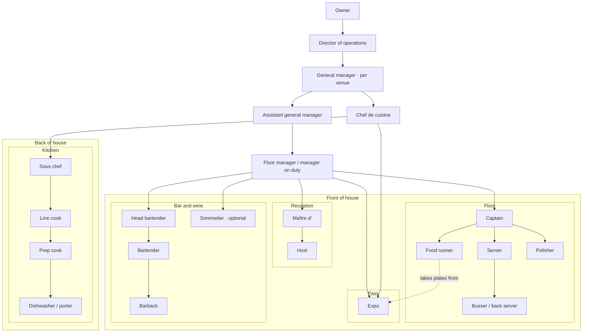

| Area | Positions (bottom to top) | Area lead | Layer of each |
|---|---|---|---|
| Floor | Polisher, busser / back server, food runner, server / front waiter, captain | Captain | support, support, support, service, lead |
| Reception | Host, maître d' | Maître d' | service, lead |
| Pass | Expo | Expo (reports to chef and manager) | service |
| Bar and wine | Barback, bartender, head bartender; sommelier (optional) | Head bartender | support, service, lead; service |
| Kitchen | Dishwasher / porter, prep cook, line cook, sous chef, chef de cuisine | Chef de cuisine | support, support, service, lead, venue management |
| Venue management | Floor manager (manager on duty), assistant general manager, general manager | General manager | venue management |
| Corporate | Director of operations, owner | Owner | corporate |

Head titles and local names (captain vs head waiter, busser vs back server) are configuration per venue. Kitchen is included so the whole restaurant runs on one system; its v1 scope is schedule, rules, side work, 86s, allergy notes and warnings `(to be validated)`.

### 2.2 What each role does and what it needs
| Position | Area | What they do | Reports to | What they need in the app | Problems the app removes |
|---|---|---|---|---|---|
| Polisher | Floor | Inspects and polishes glassware and silverware, restocks stations, folds napkins, sets extra covers. Entry point of the career | Captain / manager on duty | Schedule, station side work, glass handling rules, own warnings | Not knowing hours or which station to restock |
| Busser / back server | Floor | Resets tables, water and bread, clears between courses, coffee and drinks to the table if the house allows | Captain or server of the section | Today's section and captain, rules, schedule, own warnings | "Nobody told me my section", forgotten resets |
| Food runner | Floor | The only one who takes food from the kitchen to the table, by table number and seat | Expo | Floor plan with tables and seats, menu with allergens, 86s, schedule, own warnings | Wrong seat, unknown allergens |
| Server / front waiter | Floor | Takes the order, guides the guest through food and drinks | Captain | Section and tables, food and drinks menu with photos, 86s, pre-shift, rules, schedule, own warnings | "I didn't know the menu", missed allergies |
| Captain | Floor | Runs the service of a zone with the phone in hand: reservations, pace, kitchen; trains new staff; proposes warnings | Maître d' / manager on duty | Live section map, who is where, pre-shift, 86s, team side work, requests, propose warnings | Coordination by shouting; no record of issues |
| Host | Reception | Greets guests, manages the book, seats tables | Maître d' | Sections of the day, floor plan, reservations link, pre-shift, schedule | Not knowing sections or VIPs |
| Maître d' | Reception | Responsible for the whole dining room experience | Manager / GM | Everything the captain sees for all sections, reservations link | No single view of the room |
| Expo | Pass | Works the pass: reads every ticket, calls times, checks every plate against its ticket ("no ticket, no plate") | Chef de cuisine and manager | Full menu, floor plan with seats, allergy notes to confirm, publishes 86s | 86s not reaching the floor; allergy mix-ups |
| Barback | Bar | Ice, glassware, garnish, restocking bottles | Bartender / head bartender | Schedule, bar side work, report bottles running low, rules, own warnings | Bottles running out with no warning |
| Bartender | Bar | Prepares and serves drinks; with the barback owns every bottle running out | Head bartender / manager | Drinks menu with photos, shortages, schedule, bar rules, own warnings | "I didn't know the drinks menu" |
| Head bartender | Bar | Leads the bar team and the drinks program | Manager on duty | Bar team side work and shortages, drinks menu edits (proposed), propose warnings | No overview of the bar |
| Sommelier (optional) | Bar and wine | Wine program and service | Maître d' / manager | Wine list, menu pairings, schedule, rules | Pairings not known by servers |
| Dishwasher / porter | Kitchen | Dishes, cleaning, deliveries | Sous chef | Schedule, side work, rules, own warnings | Not knowing hours or closing duties |
| Prep cook | Kitchen | Mise en place | Sous chef | Schedule, prep side work, rules, own warnings | Same |
| Line cook | Kitchen | Cooks a station during service | Sous chef | Schedule, station side work, 86s, allergy notes, rules | 86s and allergies not shared |
| Sous chef | Kitchen | Runs the line, proposes kitchen warnings | Chef de cuisine | Kitchen team, side work, 86s, propose warnings | No record of kitchen issues |
| Chef de cuisine | Kitchen | Owns the menu content of the venue and the kitchen team | GM | Menu editing (photos, ingredients, allergens), kitchen schedule, warnings for the kitchen | Menu changes not reaching the floor |
| Floor manager (manager on duty) | Venue management | Runs the shift: opens, supervises, issues warnings, closes | AGM / GM | Shift control, live side work, shortages, warnings to issue, close | No formal close; issues in chats |
| Assistant GM | Venue management | Builds the schedule, staffs events, supports the GM | GM | Schedule, events, approvals, team | "I didn't know my shift" |
| General manager | Venue management | Owns the venue: team, standards, promotions, results | Director of operations | Venue overview in states, team, promotions, rules of the venue | Seeing the venue without being there |
| Director of operations | Corporate | Runs the four venues, sets company standards | Owner | Four venues in states, escalations, company rules, approvals of promotions | Inconsistent standards across venues |
| Owner | Corporate | Owns the company; configures and decides | - | Everything; company setup | No control without walking in |

### 2.3 Chain of supervision and mediation (ADR 0026)
- **Down the chain:** the owner and director publish company rules and events; the GM and AGM publish schedules and venue rules; the manager on duty, maître d', captains, head bartender and sous chef publish pre-shift notes, sections and 86s; the chef publishes the menu. Each item reaches exactly the people it concerns.
- **Up the chain:** staff report (shortages, requests, help, responses to warnings) to their area lead; leads propose warnings and escalate to the manager on duty; managers issue warnings, approve swaps and time off, and close; the GM sees the venue; the director sees all venues; the owner sees everything.
- **No peer to peer:** there are no direct messages and no group chats. A swap is a request to the manager naming a colleague; the system asks the colleague and the manager decides. Help and service requests go to roles, not to friends.
- **Escalation:** an unanswered request widens to the area and then to the manager on duty; a warning proposal waiting more than 24 h goes to the GM; a venue in "Action required" goes to the director.

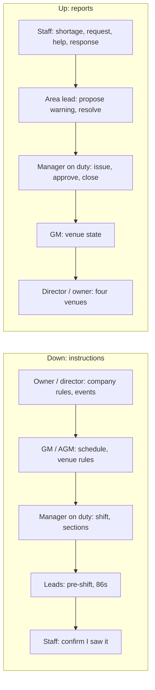

### 2.4 Access by layer
| Action | Support | Service | Lead | Venue management | Corporate |
|---|---|---|---|---|---|
| See own schedule, section and side work | yes | yes | yes | yes | yes |
| See the full section map | read | read | yes | yes | yes |
| See the menu (own area: food, drinks, wine) | yes | yes | yes | yes | yes |
| Edit the menu | no | no | head bartender, sommelier propose | chef de cuisine edits, GM approves | edit |
| Read rules and confirm | yes | yes | yes | yes | edit |
| Confirm a published schedule | yes | yes | yes | yes | - |
| Request a swap, open shift, time off; set availability | yes | yes | yes | approves | approves |
| See warnings | own | own | own team (read) | own venue | all venues |
| Log a warning | no | no | propose | issue | issue |
| Assign sections, publish 86s and pre-shift | no | expo: 86s | yes | yes | yes |
| Report a shortage | barback | bartender | yes | yes | yes |
| Build and publish the schedule, create events | no | no | no | AGM, GM, manager | yes |
| Write the shift log and the close | no | no | read | yes | read |
| Promote | no | no | propose for own team | GM proposes | director approves |
| Configure positions, venues, thresholds | no | no | no | no | yes |

Warnings are visible to the person and to their leaders; never to peers. Nobody sees money anywhere. Staff never see performance numbers.

### 2.5 Career ladders
- **Floor:** polisher → busser → food runner → server → captain → maître d' → floor manager.
- **Bar:** polisher → barback → bartender → head bartender → floor manager.
- **Kitchen:** dishwasher / porter → prep cook → line cook → sous chef → chef de cuisine.
- **Management:** floor manager → assistant GM → general manager → director of operations.

The expo is staffed from the floor (server or captain level) or by a chef `(to be validated)`. A promotion changes the primary position with a date, proposed by the GM and approved by the director `(to be validated)`; the account and its history stay. Each step can require a training checklist in the Guide and, for front of house, the menu quiz.

**2026-10-18 operational enablement amendment (ADR 0031):** Every production position has a bilingual operating playbook: intended outcome, before-service preparation, service decisions, close/handoff and its configured reporting line. The Guide links these steps to authorized screens. Training is a persistent, human-reviewed workflow, separate from promotion or permission grants. Learners may request review of a published criterion for their primary or next ladder position. Only an ancestor of the *trained position* in the venue's configured chain may review, never the learner or a peer. The review records the observed evidence and either verifies the criterion or requests more practice. No scores, automatic discipline or automatic promotion. Company training programs are immutable versions; director/owner publish revisions. Old evidence is preserved, but cannot verify a new version. Owner responsibilities are documented without a self-certification workflow.

### 2.6 User stories with acceptance criteria

**Sign in and settings**
- One screen, `/login`, username + password (managers, GM, director and owner may also use a verified email). Five wrong passwords lock 15 minutes; every failure answers `INVALID_CREDENTIALS`. A manager creates a staff account with a temporary password that must be changed on first sign-in (ADR 0003).
- `/me`: language EN/ES, Large text, theme (light by default), notifications per type, password, sign out everywhere, my warnings and my position history.

**Schedule (the core, ADR 0019)**
- The AGM or manager builds the week per venue and area: shifts per person with position, date, start and end (or "until close"), break for doubles. A double shows as one day with two blocks.
- Events are blocks in the same calendar (private dinner, buy-out, tasting, holiday) with name, time, notes per position and **required positions**. The owner or director creates events before the schedule; the venue staffs them.
- **Publish:** every scheduled person gets a push and an in-app card "Your schedule for Oct 19–25 is out" and taps **I saw it**. The manager sees who confirmed; at 24 h unconfirmed people get a reminder and the manager a list. Changes after publishing notify only the people affected and need a new confirmation.
- Availability, time off, swaps (a request to the manager naming a colleague; the system asks the colleague; the manager decides) and open shifts (claimed, manager approves). Every step recorded; no direct messages.
- Pre-shift is part of the shift. Late and no-show marks by the manager (no time clock); they offer "Log a warning" with the punctuality rule prefilled `(to be validated)`.
- Migration: import people, positions and the current schedule from a 7shifts CSV export `(to be validated)`.

**Today (every position)**
- My shift today, my area, section and lead, pre-shift notes, 86s for my area, my next side work item, announcements, and anything waiting for my confirmation (schedule, menu change, rule, warning) at the top.

**Menu with photos (food, drinks, wine)**
- By category, with a 4:3 photo, name, description, ingredients, allergens as chips, pairing and tasting-menu order when they apply. No prices (ADR 0018).
- 86s show on the item and at the top during the shift.
- A **new or changed item** asks every front-of-house person (and line cooks for food) to open it and tap **I saw it** before their next shift (ADR 0022). Optional menu quiz, required for promotions to server and above.
- The chef de cuisine edits food; the head bartender and sommelier propose drinks and wine; the GM approves; the owner sees all.

**Sections and floor plan (ADR 0021)**
- Each venue has a floor plan: sections, tables with numbers, seats. The maître d', captain or manager assigns today's sections. Staff see their section; leads see the live map with who is where. Runners and expo see seats.

**86s and pre-shift notes**
- Expo, sous chef, chef, captain or manager mark an item 86 for the shift; everyone concerned sees it in Today and on the menu. Pre-shift notes by leads and managers. Both expire at close and go into the close.

**Table notes**
- Captain or server adds a note to a table for the shift: allergy (with seat), VIP, occasion, preference; ≤ 140 characters; no guest contact details. Allergy notes go to the expo and line cooks, and the expo confirms them. Deleted after 30 days.

**Side work**
- When the manager opens the shift, each scheduled person gets the checklist of their position, area and section for the phase; photo-required items; weekly items ("Monday: deep clean of the bar fridges"); estimated minutes for the side-work indicator (tipped positions, NY limit of 2 hours or 20 % of the shift, shown to managers as a state).

**Bar shortages (ADR 0023)**
- Bartender and barback mark items **Low** or **Out**; the manager on duty or head bartender marks **Restocked** or **Ordered**; open ones carry over and go into the close.

**Requests (ADR 0013)**
- Water, Clear table, Help, routed by section and role; escalate at 90 s. Not a chat.

**Announcements**
- One way, down the chain: the owner and director to any venue, the GM and managers to their venue, areas or positions; optional "requires confirmation"; read receipts for the sender. No replies, no threads.

**Rules**
- Company, venue, area and position rule sets, versioned; a new version is confirmed before the next shift. "No ticket, no plate" is an expo and runner rule. The tip-pool policy, if used, is a rule set (section 2.8).

**Warnings (ADR 0007, 0026)**
1. An area lead (captain, maître d', head bartender, sous chef) **proposes**; the manager on duty or above **issues** or discards. Managers and above may issue directly. Under 30 s.
2. The person gets it by push and in the app, in their language: the rule, what happened, how to do it right. Notifications never show the content.
3. The person confirms and may respond; the response goes to the issuer, not to colleagues.
4. State over a rolling 30 days, with thresholds set by the owner: Up to date, Attention, Follow-up, Review. Types verbal / written / final can replace severity `(to be validated)`.
5. Proposals waiting more than 24 h escalate to the GM. Void within 24 h with a reason. Everything audited.
6. Leaders see their people by state and name, with the rules most missed and recognition (shifts without a warning). No scores.

**Manager close (ADR 0008, 0018)**
- Incidents, late and no-shows, side work still open, open shortages, 86s of the service, cleaning status, staff notes and notes for the next shift. No money. Submitting locks the shift; it goes to the GM, the director and the next pre-shift.

**Venue and company views (ADR 0027)**
- GM: the venue in states (shift, close, schedule confirmations, side work, shortages, people in Review) with names behind each state.
- Director and owner: the four venues, each with one overall state (**On track**, **Needs attention**, **Action required**) and the reasons in words ("Close missing", "3 people have not confirmed the schedule"). No money, no percentages.

**Owner setup**
- Venues and services, areas and positions with local names, floor plans, company menu, rule sets, events, warning thresholds, hours threshold, side-work limit, tip policy, imports.

### 2.7 Typical service day (configured per venue)
| Block | Usual time | Who |
|---|---|---|
| Kitchen prep | ~9:00–11:00 | Prep cooks, dishwasher, sous chef |
| Lunch set-up | ~10:00–11:00 | Polisher, bussers, barback, first manager |
| Lunch pre-shift | ~30 min before opening | Floor, bar, expo + manager |
| Lunch service | ~11:30–15:00 | Full floor, bar, pass, line |
| Changeover | ~15:00–16:30 | Lunch close, dinner set-up, manager log handover |
| Dinner pre-shift | ~30 min before opening | Floor, bar, expo + manager; chef walks the menu |
| Dinner service | ~17:00–23:00 | Full team; peak 19:00–21:00 |
| Close | until ~00:30 | Closers in every area, manager files the close |

Services are configurable per venue and weekday; dinner-only venues drop the lunch blocks. Source: research; to confirm venue by venue.

### 2.8 Tip policy (configuration only, P3, ADR 0024)
New York requires a written tip-pool policy and excludes managers with real authority; a captain who serves tables can take part. The First stores only the rules (participating positions, points per position and venue, the written text that tipped staff confirm). It never stores or calculates amounts. Counsel validates before publishing; whether the owner wants it is open.

### 2.9 Business rules
| Rule | Value | Where |
|---|---|---|
| No money | No price, sales, cost, pay or tip amount is stored or shown | ADR 0018, `no-money-check` |
| States, not scores | Staff never see performance numbers; leaders see states and names; venues have an overall state | ADR 0027, `lib/domain/states.ts` |
| Mediation | No direct messages; requests, swaps and reports go through roles and the chain | ADR 0026 |
| Tenancy | One company, venues under it; every record carries `companyId` or `venueId` | ADR 0002 |
| Areas and positions | Seven areas; one primary position, enabled positions, dated history | ADR 0020 |
| Shift | `scheduled → open → closing → closed` per venue and service | ADR 0008 |
| Schedule | Versioned weeks; confirmation per person and version; reminder at 24 h | ADR 0019 |
| Swap | Request to the manager naming a colleague; colleague accepts through the system; manager decides | `schedule.*Swap` |
| Event | Block with required positions; shifts link to it | `events` |
| Menu confirmation | New or changed item confirmed before the next shift | ADR 0022 |
| Rules version | Confirmed before the next shift | `ruleAcks` |
| Warning | Tied to a rule; lead proposes, manager issues; escalates to GM after 24 h; 30-day window | ADR 0007, 0026 |
| Visibility | Own warnings for staff; team for leads; venue for managers and GM; all for director and owner; never peers | `permissions.ts` |
| 86s and pre-shift | Per shift, expire at close | `eightySix`, `preShiftNotes` |
| Table notes | ≤ 140 characters, no contact details, 30 days | ADR 0016 |
| Requests | Water, clear, help; escalate at 90 s | ADR 0013 |
| Bar shortages | Low / Out → Restocked / Ordered | ADR 0023 |
| Side-work limit | Tipped positions: state "Over limit" to managers above 2 h or 20 % | `sideWork.ts` |
| Venue state | On track / Needs attention / Action required from closes, confirmations, side work, shortages, Review states | `venueState()` |
| Time | `America/New_York` | `lib/time.ts` |

---

## 3. Flows

### 3.1 The operating cycle of a top-tier restaurant (macro)
How the whole system fits together, week and day, across every level.

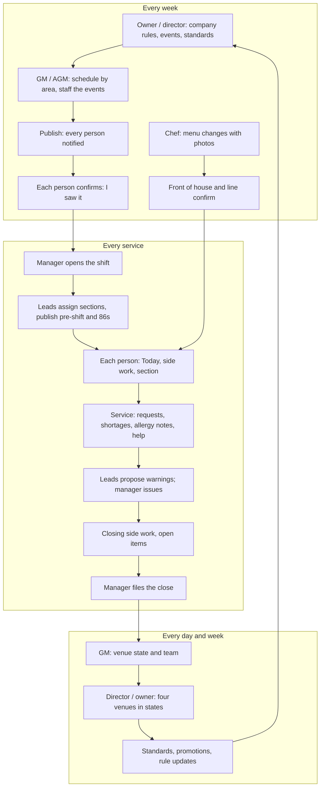

### 3.2 A service, by area (swimlanes)
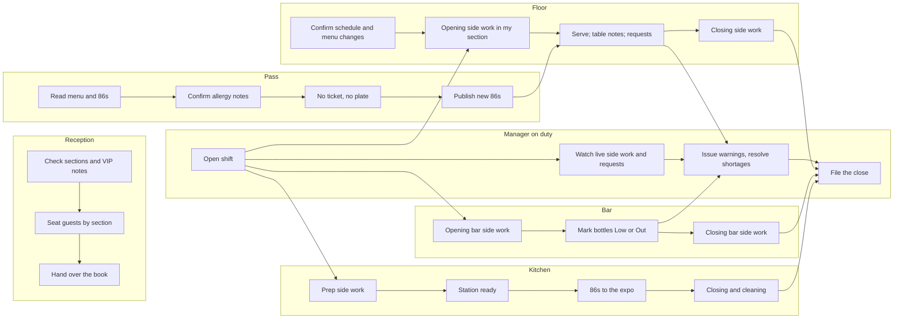

### 3.3 Schedule week
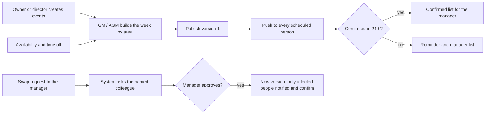

### 3.4 Shift lifecycle
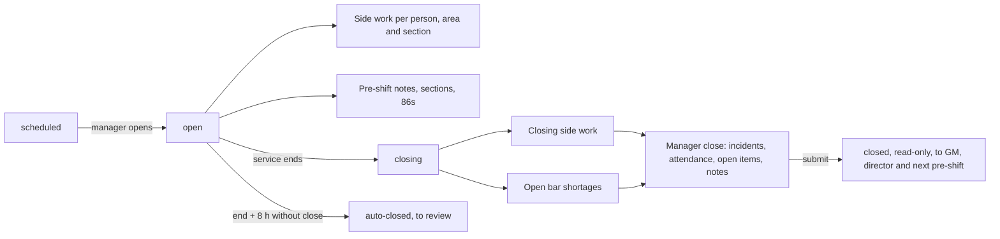

### 3.5 Warning through the chain
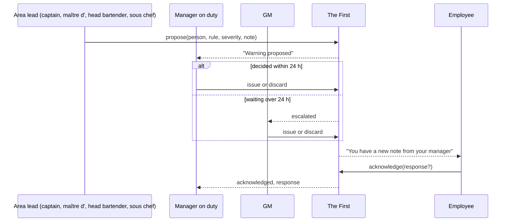

### 3.6 Bar shortage
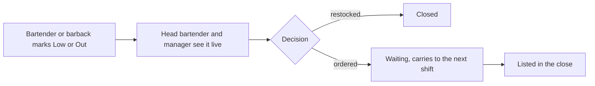

### 3.7 Journey of each role (what they open, in order)
| Role | Before the shift | During the shift | After the shift |
|---|---|---|---|
| Polisher | Confirm schedule; read station side work | Polish and restock; mark items done (photo where asked) | Closing side work |
| Busser | Confirm schedule and rules; see section and captain | Reset tables, water, clear; answer Water and Clear requests | Closing side work in the section |
| Food runner | Confirm schedule; read 86s and allergy notes | Take plates from the expo to table and seat | Closing side work |
| Server | Confirm schedule and menu changes; read pre-shift, 86s, section | Serve; add table notes; request water, clear or help | Closing side work; hand over open tables |
| Captain | Assign sections; run pre-shift | Live map; answer help; resolve requests; propose warnings | Hand over to the manager |
| Host | Read sections and VIP notes | Seat guests by section | Hand over the book |
| Maître d' | Review sections with captains; pre-shift | Whole-room map; propose warnings | Notes for the close |
| Expo | Read menu and 86s | Confirm allergy notes; "no ticket, no plate"; publish 86s | 86s summary into the close |
| Barback | Confirm schedule; opening bar side work | Restock; mark bottles Low or Out | Closing bar side work |
| Bartender | Confirm schedule and drinks changes | Serve; mark shortages | Closing bar side work |
| Head bartender | Check open shortages; bar side work | Resolve shortages; propose bar warnings | Bar notes for the close |
| Dishwasher, prep, line cook | Confirm schedule; prep or station side work | Cook; 86s to the expo | Closing and cleaning |
| Sous chef | Check prep; 86s | Run the line; propose kitchen warnings | Kitchen notes for the close |
| Chef de cuisine | Publish menu changes with photos | Watch 86s | Review the close |
| Manager on duty | Open the shift; check confirmations | Live side work, requests, shortages; issue warnings | File the close |
| AGM | Build and publish the schedule; staff events | Approve swaps and time off | Confirmations list |
| GM | Venue state; promotions | Escalations | Read closes; standards |
| Director of operations | Four venues in states | Escalations, approvals of promotions | Company standards and rules |
| Owner | Company setup, events | Read-only oversight | Decisions |

---

## 4. Experience, brand and art direction

### 4.1 Direction: executive hospitality (ADR 0025, color superseded by ADR 0029 on 2026-10-18)
- **Design read:** an executive operations app for a top-tier New York restaurant group. Light, calm, precise, quietly confident; daylight dining room, not nightlife. Dials: variance 3, motion 2, density 4.
- **Color (2026-10-18, owner request):** white primary, ink `#111311` secondary, **burgundy** `#6B2337` brand (the mark, the primary action, the active tab, progress); pressed `#50182A`, selected surface `#F2DFE5`, dark brand `#D6A6B5`. Status colors are separate and carry meaning only. All text pairs AA; control borders 3:1.
- **Logo (2026-10-18, owner request, ADR 0030):** an original lion head in right-facing profile, drawn from scratch in burgundy with negative-space mane cuts. Delivery source: `public/brand/mark.svg`; generated install icons share that source. THE FIRST uses Figtree SemiBold caps, tracked. This replaces the temporary neutral mark and historical reference drawings.
- **Type:** Figtree for everything (body 17, inputs ≥ 16), IBM Plex Mono for times and table numbers. Large text × 1.18.
- **Theme:** light by default; dark is an optional setting for dim rooms, never the default or the brand's face.
- **States, not scores (ADR 0027):** chips and words (Confirmed, Pending, Late, Low, On track, Needs attention, Action required); no money, no percentages on any screen staff see.
- **Shape:** one soft radius scale; 48 px targets, 56 px for primary actions and checklist rows; hairline dividers; at most one lifted card per screen.
- **Never:** dark screens by default, neon, gradients, club or nightlife imagery and copy, emojis, leaderboards.

### 4.2 Design system (`components/ui/`, composed, never restyled; ADR 0009)
From OSCURA, re-tokened: `Button`, `ConfirmButton`, `Field` family, `ChoiceCard`/`ChoicePill`, `Tabs`, `Sheet`, `Skeleton`/`EmptyState`/`ErrorState`/`OfflineNote`/`InlineError`.
New:
- Shell: `BottomNav` (max 5 tabs per position), `LionMark`, `Wordmark`, `AreaBadge`, `PositionBadge`
- Confirmations: `ConfirmCard` (schedule, menu, rule, warning), `AckBanner` ("I saw it")
- Schedule: `MyWeek`, `ShiftCard`, `EventBlock` (required positions vs filled, as states), `WeekGrid`, `PublishBar`, `ConfirmationsList`, `SwapSheet`, `OpenShiftCard`, `AvailabilityGrid`, `TimeOffForm`
- Floor: `FloorPlan`, `SectionCard`, `LiveMap`, `TableNoteChip`, `PassView`, `RequestButton`, `RequestSheet`, `RequestQueue`
- Menu: `MenuCard`, `MenuDetail`, `AllergenChips`, `EightySixBadge`, `QuizCard`
- Work: `ChecklistRow`, `ProgressBar` (no numbers shown to staff), `SideWorkState` (managers)
- Bar: `ShortageRow`, `ShortageBoard`
- People: `StatusChip`, `WarningCard`, `ProposalCard`, `LadderView`, `OrgChart` (areas and chain)
- Leaders: `VenueStateCard` (On track, Needs attention, Action required + reasons), `ReasonList`

### 4.3 Voice and microcopy
Corporate and respectful, short, verbs first: "Confirm your schedule", "Reset tables 20 to 27". Warnings name the rule and how to do it right; never shaming. Confirmations name what is confirmed ("I saw my schedule for Oct 19–25"). Spanish is neutral with "tú". No emojis, no em dashes, no slang, no nightlife words.

### 4.4 Motion
No premium motion layer: operational tool. Press feedback 120 ms, sheets 320 ms, check fill, progress; `prefers-reduced-motion` removes them. OSCURA's mobile-native baseline applies.

---

## 5. Architecture

### 5.1 Style
Modular monolith as in OSCURA: one Next.js app and one Convex deployment, modules by folder, guarded by position layer and venue. Convex gives reactivity (live section map, live shortages, confirmations) and transactions (swaps, publishes, closes).

### 5.2 Context and containers
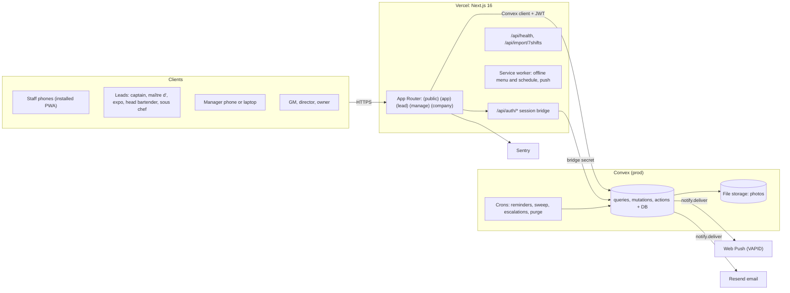

### 5.3 Stack (pinned at Sprint 0 to OSCURA's versions)
| Layer | Choice | Version |
|---|---|---|
| Web | Next.js App Router, `cacheComponents` | 16.4 |
| UI | React, Tailwind v4, Phosphor icons, `sonner`, `vaul` | 19.3 / 4 |
| Language | TypeScript strict | 5.x |
| Backend | Convex + `convex-helpers` | 1.46 |
| Auth | OSCURA session bridge (username + password, PBKDF2, RS256 cookie, Convex `customJwt`) | ADR 0003 |
| Validation | Zod in `schemas/`, shared | 3.x |
| Push | `web-push` (VAPID) from a Convex action | 3.x |
| Email | Resend through the outbound queue | - |
| Monitoring | Sentry with OSCURA scrubbing | - |
| Tests | Vitest, convex-test, Playwright + axe, Lighthouse CI | - |
| Hosting | Vercel + Convex Cloud | - |

### 5.4 Communication
Client ↔ Convex reactive queries and mutations; sign-in through the Next.js bridge; photos uploaded straight to Convex storage and read through access-checked queries; notifications enqueued in the same transaction and delivered by an action (push first, email fallback for managers and owner, 3 retries); the 7shifts CSV import goes through a route handler that validates and calls an internal mutation in batches.

---

## 6. Frontend

### 6.1 Routes
Groups: `(public)`, `(app)` every position, `(lead)` area leads (captain, maître d', host, expo, head bartender, sous chef), `(manage)` venue management (manager on duty, AGM, GM, chef de cuisine for the menu), `(company)` director of operations and owner. Each group has `loading.tsx` and `error.tsx`. Tabs per position in 6.1.1.

| Route | Who | Content |
|---|---|---|
| `/` | Public | Brand page, sign in, install the app |
| `/login` | All | Username or email + password; first sign-in sets a password |
| `/today` | Staff+ | Shift, section, pre-shift, 86s, next side work, things to confirm |
| `/schedule` | Staff+ | My week (doubles as two blocks), events, confirm, swap, open shifts, availability, time off |
| `/menu`, `/menu/[itemId]` | Staff+ | Photos, allergens, 86s, confirm changes, quiz |
| `/tasks` | Staff+ | My side work for the phase |
| `/section` | Staff+ | My section on the floor plan, table notes, requests for me |
| `/bar` | Bartender, barback, manager | Shortage list: Low, Out; my reports |
| `/rules` | Staff+ | My rules, confirm new versions |
| `/messages` | Staff+ | Announcements, confirm |
| `/me` | All | My warnings and state, position history, preferences |
| `/lead/floor` | Captain, maître d', host, manager | Live map: sections, who is where, table notes, requests |
| `/lead/pass` | Expo, manager | Pass view: 86s, allergy notes to confirm, floor plan with seats |
| `/lead/preshift` | Captain, maître d', head bartender, sous chef, manager | Write pre-shift notes and 86s |
| `/lead/warnings/new` | Captain, maître d', head bartender, sous chef | Propose a warning |
| `/lead/bar` | Head bartender | Bar team side work and shortages |
| `/lead/kitchen` | Sous chef | Kitchen team side work, 86s, allergy notes |
| `/manage` | Manager | Shift control: open, live side work, sections, log |
| `/manage/schedule` | Manager | Week grid, event staffing, publish, confirmations, swaps, open shifts, time off, hours and side-work alerts |
| `/manage/warnings` | Manager | Proposals to issue, issue directly, list |
| `/manage/team`, `/manage/team/[userId]` | Manager, GM | People by area with their state, enabled positions, promotions (proposed) |
| `/manage/menu` | Chef de cuisine, GM | Edit food (chef), approve drinks and wine proposals (GM) |
| `/manage/venue` | GM | The venue in states with reasons and names |
| `/manage/bar` | Manager | Shortage board: restocked, ordered |
| `/manage/messages/new` | Manager | Announcement to the venue or to positions |
| `/manage/close` | Manager | The close (no money) |
| `/manage/setup/{tasks,sections,rules,staff,menu-availability}` | Manager | Venue setup |
| `/company` | Director, owner | Four venues, each with an overall state and its reasons |
| `/company/venues/[venueId]` | Director, owner | Venue detail in states |
| `/company/org` | Director, owner | Organization chart by area and the chain of supervision |
| `/company/setup/{venues,areas,positions,floor-plans,menu,rules,events,thresholds,tip-policy,import}` | Owner (director: rules, events, thresholds) | Company setup |
| `/guide` | All | How-to per screen and training checklist per position |
| `/training` | All | Own primary/next-position training, request review, supervisor feedback and evidence history |
| `/lead/training` | Authorized supervisors | Paginated review queue for the configured reporting chain |
| `/company/setup/training` | Director, owner | Publish versioned EN/ES training criteria and required demonstration |
| `/legal/[doc]` | Public | Terms, privacy (staff notice) |

#### 6.1.1 Bottom tabs per position (max 5)
| Positions | Tabs |
|---|---|
| Polisher, busser, dishwasher, prep cook | Today · Schedule · Section (floor) or Station (kitchen) · Rules · Me |
| Food runner, server, sommelier | Today · Schedule · Section · Menu · Me |
| Barback, bartender | Today · Schedule · Bar · Menu · Me |
| Line cook | Today · Schedule · Station · Menu · Me |
| Expo | Pass · Schedule · Menu · Rules · Me |
| Captain, maître d', host | Floor · Schedule · Pre-shift · Menu · Me |
| Head bartender | Bar · Schedule · Pre-shift · Menu · Me |
| Sous chef | Kitchen · Schedule · Pre-shift · Menu · Me |
| Manager on duty, AGM | Shift · Schedule · Team · Close · Announce |
| Chef de cuisine | Kitchen · Menu · Schedule · Team · Announce |
| General manager | Venue · Schedule · Team · Closes · Announce |
| Director of operations, owner | Company · Org · Schedule · Announce |

### 6.2 Render and caching
Client shells per group, data from Convex. Static: `/`, `/guide`, `/legal/*`. The service worker caches the shell, my published schedule, the menu and its photos (50 MB cap) for offline use.

### 6.3 State and data
`lib/backend/hooks.ts` (Convex or preview handlers, ADR 0010). Current venue, shift and position from `useCurrentShift()`. Preferences in the user record, mirrored in a cookie.

Preview reliability amendment (2026-10-18, ADR 0030): sample records remain shared in localStorage; identity is private to each tab in sessionStorage. Rehydrating shared records preserves the tab identity and does not write them back. Query results and errors belong to a function, arguments and identity; signed-out protected queries do not run. Every operational page provides localized contextual instructions through its page header. Demo entry presents named sample accounts before manual credentials, explains their role, and reports failures inline.

Preview concurrency clarification (2026-10-18): transactions bind the initiating identity before waiting. Where the browser supports Web Locks, a shared origin lock protects rehydration plus mutation plus persistence across tabs. This prevents simultaneous demonstrations/reviews or preferences from losing a committed write. The existing promise queue remains the single-tab fallback for browsers without Web Locks; live cross-device transactions remain Convex's responsibility.

Preview ordering clarification (2026-10-18): creation times use the real millisecond timestamp, with monotonically generated IDs breaking same-millisecond ties. Random timestamp jitter is not used: it reordered seed items and evidence, making unchanged shortage reports and their notification expectations nondeterministic. No existing preview records are rewritten.

### 6.4 Forms and validation
Shared Zod schemas. Label above, error below. Photos compressed to ≤ 400 KB.

### 6.5 Accessibility
WCAG 2.2 AA, status never by color alone, 48 px targets, Large text, `prefers-reduced-motion`, announcements on confirm and submit; EN and ES.

### 6.6 Performance budgets
| Budget | Threshold |
|---|---|
| Route JS (gzip) | ≤ 170 KB on staff routes; ≤ 230 KB on `/manage/schedule` and `/company/*` |
| 4G mid-range phone | LCP < 2.5 s, INP < 200 ms, CLS < 0.1 |
| Photos | ≤ 120 KB thumbnails, ≤ 400 KB detail |

### 6.7 i18n and metadata
`messages/{en,es}.json` with identical keys; content as `{en, es}`; English default; noindex except `/`.

### 6.8 Product analytics
Events in Convex: `schedule_confirmed`, `menu_confirmed`, `rule_confirmed`, `task_checked`, `warning_proposed`, `warning_issued` (form duration), `shortage_reported`, `request_created`, `close_submitted`. No third-party trackers.

### 6.9 States
Skeleton, empty (with what to do), error with retry, offline (cached data + banner), locked (shift not open, something to confirm first).

---

## 7. Backend: functions and contracts (Convex)

### 7.1 Domain boundaries
`org` · `auth` · `staff` (positions, ladder) · `schedule` (weeks, shifts, events, availability, time off, swaps, open shifts, confirmations) · `shifts` (lifecycle) · `floor` (plans, sections, table notes, requests) · `menu` (items, 86s, confirmations, quiz) · `preshift` · `tasks` (side work) · `bar` (shortages, optional counts) · `rules` · `warnings` · `messages` · `close` · `reports` · `notify` · `files` · `tips` (policy only) · `audit` · `seed` · `import`.

### 7.2 Contracts
Every function: validators + Zod, `requireUser`, `requireVenue(ctx, venueId)`, `requireCan(ctx, action)`; errors `ConvexError({code, message, details?})`.

| Module | Function | Kind | Access | Contract |
|---|---|---|---|---|
| auth | signIn, changePassword, revokeSessions, requestCode, verifyCode, me | as OSCURA | - | `me` returns `{id, name, primaryPosition, enabledPositions, title?, layer, venues, locale, largeText, theme}` |
| org | venues, upsertVenue | q/m | owner | `{name, slug, services[{key, weekdays[], startsAt, endsAt, preShiftMin}]}` |
| staff | list, upsert, deactivate, resetPassword | q/m | manager (own venue, support to lead layers), owner (all) | `upsert {userId?, name, username, primaryPosition, enabledPositions[], title?, venueIds[], locale}` |
| staff | promote | mutation | GM proposes, director approves `(to be validated)` | `{userId, toPosition, effectiveFrom, note?}` → history row |
| positions | list, configure | q/m | staff+ / owner | Positions used per venue, local names (captain vs head waiter), layer |
| schedule | week | query | staff+ (own), manager (venue) | `{venueId, weekStart}` → shifts, events, version, confirmations |
| schedule | upsertShift, removeShift | mutation | manager | `{shiftId?, venueId, userId?, position, date, start, end?, untilClose, breakMin?, eventId?, open?}`; `NOT_ENABLED` if the person cannot work that position |
| schedule | publish | mutation | manager | `{venueId, weekStart}` → `{version, notified}`; later publishes notify only the people who changed |
| schedule | confirm | mutation | the scheduled person | `{venueId, weekStart, version}`; `VERSION_STALE` |
| schedule | confirmations | query | manager | Who confirmed which version |
| schedule | setAvailability, requestTimeOff, decideTimeOff | mutation | staff / manager | Weekly availability; time off `{from, to, reason?}` → approve or deny |
| schedule | requestSwap, answerSwap, decideSwap | mutation | staff (to the manager, naming a colleague) / colleague (through the system) / manager | No direct messages; the two shifts swap atomically after both steps; `SWAP_CONFLICT` |
| schedule | offerOpenShift, claimOpenShift, decideClaim | mutation | manager / enabled staff / manager | `ALREADY_CLAIMED` |
| schedule | markAttendance | mutation | manager | `{shiftId, status: on_time\|late\|no_show, minutes?}` |
| events | list, upsert, remove | q/m | staff+ (read), owner and manager | `{eventId?, venueId, kind: private_dinner\|buyout\|tasting\|holiday\|other, name{en,es}, date, start, end, notes{en,es}, required[{position, count}]}` |
| shifts | current, open, startClosing, sweep | q/m | staff+ / manager / cron | Lifecycle (section 2.6) |
| floor | plan, upsertPlan | q/m | staff+ / owner, manager | `{venueId, sections[{id, name, tables[{number, seats, x, y}]}]}` |
| floor | assignSections, map | m/q | lead, manager / lead+ | Today's assignment; map with who is where |
| floor | mySection | query | staff+ | My section, tables, notes, requests for me |
| floor | addTableNote, confirmAllergy, archive | mutation | captain, server / expo / system | ≤ 140 characters; kinds allergy (seat required), vip, occasion, preference |
| requests | create, claim, done, cancel, escalate | m | staff+ / receivers / scheduler | Kinds `water\|clear\|help` only |
| menu | list, get, upsert, setAvailability, reorder | q/m | staff+ / owner (catalog), manager (availability) | No price field (ADR 0018) |
| menu | set86, clear86 | mutation | expo, lead, manager | `{shiftId, itemId, note?}` |
| menu | pendingAcks, confirm | q/m | front of house | Items new or changed since my last confirmation |
| menu | quiz, submitQuiz | q/m | staff | Optional |
| preshift | notes, upsert | q/m | staff+ / lead, manager | Per shift, expire at close |
| tasks | templates, upsertTemplate, myRun, check, excuse, progress | q/m | staff+ / manager | Items with `estimatedMin?`, `photoRequired`, `weekdays?`, `sectionId?`, `positions[]` |
| tasks | sideWorkLoad | query | manager | `{venueId, weekStart}` → per tipped shift: non-tipped minutes vs the limits |
| bar | items, upsertItem | q/m | manager, owner | `{itemId?, venueId, name, kind: bottle\|juice\|soda\|ice\|garnish\|other, active}` |
| bar | report | mutation | bartender, barback, lead, manager | `{shiftId, itemId, level: low\|out, note?, photoId?}` |
| bar | resolve | mutation | manager | `{shortageId, status: restocked\|ordered}` |
| bar | open, forShift | query | bar staff, manager, owner | Live list |
| rules | forMe, sets, upsertSet, acknowledge | q/m | staff+ / manager, owner | Scopes `company \| venue \| position`, versioned |
| warnings | propose | mutation | area leads (captain, maître d', head bartender, sous chef) | `{venueId, userId, ruleId, severity, note?, photoId?}` → proposal; `RULE_NOT_FOR_POSITION`, `FORBIDDEN` (self) |
| warnings | issue, discard | mutation | manager, owner | `{proposalId}` or direct `{venueId, userId, ruleId, severity, note?, photoId?}` |
| warnings | acknowledge, void, mine, forVenue, forUser, thresholds, setThresholds | q/m | per matrix | `forVenue` is read-only for captains, own team only |
| messages | send, inbox, get, markRead, confirm, receipts | q/m | manager, owner / staff+ | Audience `{venueIds[], positions[]?}`; no replies |
| close | draft, save, submit, get, list | q/m | manager / owner | `save {shiftId, incidents[], attendance[], openItems[], cleaning, staffNotes, nextShiftNotes}`; no money fields |
| reports | team, venueState, company | query | manager, GM / GM / director, owner | States with reasons and names (`venueState`, `personState`); never money; no percentages returned to staff routes |
| org | chart | query | staff+ | Areas, positions and the chain of supervision of my venue (names visible to leads and above) |
| tips | policy, setPolicy, acknowledge | q/m | tipped staff / owner | `{venueId, participants[{position, points}], text{en,es}, version}`; never amounts (P3) |
| import | sevenShifts | action | owner | CSV of people, positions and schedule → dry-run report, then apply |
| notify | subscribe, deliver | m/action | user / queue | Push first, email fallback |
| files | generateUploadUrl, attach, url | m/q | user | Images ≤ 5 MB; `url` checks access |
| audit | list | query | owner | Filter by actor, entity, date |
| training | mine, requestReview | q/m | learner | `{venueId, position?, version, stepKey, note?}`; primary/next position only; immutable criterion snapshot and evidence history |
| training | queue, review, history | q/m/q | configured supervisor, learner for own history | Native pagination (1 to 50); review `{recordId, revision, decision: verified\|needs_practice, note}`; non-self ancestor of trained position; stale revision/version refused |
| training | program, publish | q/m | director, owner | `{venueId, position, expectedVersion, title{en,es}, steps[{key,label{en,es},evidence{en,es}}]}`; 1 to 12 unique-key criteria; immutable company version |
| seed | bootstrap, demo | internal | CLI | Company, 4 venues, owner, positions, rules, sample menu, floor plans, a demo week |

**Error codes:** `UNAUTHENTICATED`, `FORBIDDEN`, `NOT_FOUND`, `INVALID_INPUT`, `RATE_LIMITED`, `INVALID_CREDENTIALS`, `ACCOUNT_LOCKED`, `INVALID_CODE`, `CODE_EXPIRED`, `VENUE_FORBIDDEN`, `NOT_ENABLED`, `SHIFT_NOT_OPEN`, `OTHER_SHIFT_OPEN`, `NOT_SCHEDULED`, `INVALID_TRANSITION`, `WEEK_NOT_PUBLISHED`, `VERSION_STALE`, `SWAP_CONFLICT`, `ALREADY_CLAIMED`, `RUNS_OPEN`, `PHOTO_REQUIRED`, `ACK_REQUIRED`, `RULE_REQUIRED`, `RULE_NOT_FOR_POSITION`, `TOO_LATE`, `REQUEST_CLOSED`, `FILE_TOO_LARGE`, `FILE_TYPE`, `NO_RECIPIENTS`.

### 7.3 Authentication and authorization
OSCURA session bridge (ADR 0003). `requireCan(ctx, action)` resolves the layer from the position the person works in the current shift (or the primary position outside a shift) and checks the matrix in `lib/domain/permissions.ts`. The UI uses the same matrix to hide actions; the server decides.

### 7.4 Errors
One shape, `toClientError()`, messages translated by code. Bridge mutations return `{ok:false, error}`.

### 7.5 Async and cron
| Job | Schedule | Does |
|---|---|---|
| `schedule.remind` | hourly | Reminds unconfirmed people 24 h after publishing; sends the manager the list |
| `schedule.shiftReminder` | every 15 min | Push before each shift and before pre-shift `(to be validated)` |
| `shift.sweep` | hourly | Notifies at end + 4 h; auto-closes at end + 8 h, to review |
| `tasks.lateCheck` | every 15 min | Marks late runs, notifies the manager once |
| `requests.escalate` | 90 s after each request | Widens recipients |
| `warnings.escalate` | hourly | Proposals waiting over 24 h go to the GM |
| `warnings.digest` | daily 10:00 NY | Director and owner digest: venues in Action required, new Review states |
| `purge` | daily | Table notes after 30 days, unattached uploads after 24 h |

### 7.6 Integrations
Web Push (VAPID; iOS needs the installed PWA), Resend, **7shifts CSV import** for migration `(to be validated against a real export)`, reservations (Resy, OpenTable, SevenRooms or Tock) as a link-out in v1 and a read-only integration in P3 `(to be validated)`, no POS.

### 7.7 Payments
Not applicable (ADR 0018).

### 7.8 Rate limits
| Key | Limit |
|---|---|
| `signin:<login>` | 10 / 10 min, lockout 5 → 15 min |
| `warn:<actorId>` | 30 / hour |
| `msg:<actorId>` | 20 / hour |
| `req:<userId>` | 40 / hour (help never limited) |
| `swap:<userId>` | 10 / day |
| `upload:<userId>` | 60 / hour |

---

## 8. Data

### 8.1 Model
Training addition (2026-10-18, ADR 0031): `trainingPrograms` carries company, trained position, immutable version, bilingual title/criteria/demonstration, publisher and time. `trainingRecords` carries venue, person, trained position/version/criterion key, immutable criterion snapshot, current state, monotonic revision and update time. `trainingEvents` carries venue, record, actor, state/revision, observation and time; events are append-only. Current criterion reads are capped at 12, inline history at 20 and older criterion summaries at 50; complete event reads and review queues use bounded native pagination. Default v1 programs require no data rewrite or preview reseed.
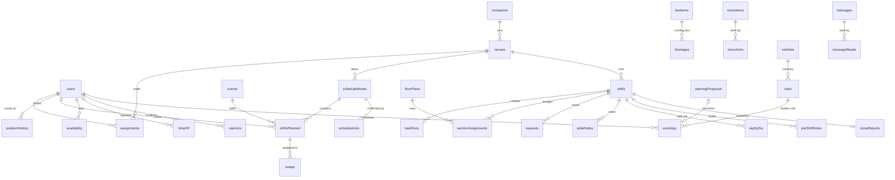

| Group | Table | Key fields | Indexes |
|---|---|---|---|
| Org | companies | name, slug, timezone, thresholds{warnings, weeklyHours, sideWork}, createdAt | by_slug |
| Org | venues | companyId, name, slug, services[{key, weekdays[], startsAt, endsAt, preShiftMin}], areasUsed[], positionsUsed[], localNames{}, active | by_company |
| Org | chainOverrides | venueId, position, reportsTo (position) | by_venue |
| People | users | username, email?, name, area, primaryPosition, enabledPositions[], title?, active, passwordHash, mustChangePassword, failedLogins, lockedUntil?, sessionVersion, locale, largeText, theme, notifyPrefs, createdAt | by_username, by_email |
| People | assignments | userId, venueId, since | by_user, by_venue |
| People | positionHistory | userId, fromPosition?, toPosition, effectiveFrom, proposedBy, approvedBy?, note? | by_user |
| Schedule | scheduleWeeks | venueId, weekStart, status (draft\|published), version, publishedAt?, publishedBy? | by_venue_week |
| Schedule | shiftsPlanned | weekId, venueId, userId?, position, date, start, end?, untilClose, breakMin?, eventId?, open, attendance?, changedInVersion | by_week, by_user_date, by_event |
| Schedule | scheduleAcks | weekId, userId, version, at | by_week_user |
| Schedule | availability | userId, weekday, from, to, available | by_user |
| Schedule | timeOff | userId, from, to, reason?, status, decidedBy?, at | by_user, by_status |
| Schedule | swaps | fromShiftId, toShiftId?, requestedBy, colleagueId, status (asked\|accepted\|approved\|denied\|canceled), decidedBy? | by_status |
| Schedule | openShiftClaims | shiftPlannedId, userId, status, decidedBy? | by_shift |
| Schedule | events | venueId, kind, name{en,es}, date, start, end, notes{en,es}, required[{position, count}], createdBy | by_venue_date |
| Shifts | shifts | venueId, date, service, status, openedBy?, openedAt?, closingAt?, closedAt?, autoClosedAt?, reviewedAt? | by_venue_date |
| Shifts | preShiftNotes | shiftId, text{en,es}, by, at | by_shift |
| Floor | floorPlans | venueId, version, sections[{id, name, tables[{number, seats, x, y}]}] | by_venue |
| Floor | sectionAssignments | shiftId, sectionId, userIds[], by, at | by_shift |
| Floor | tableNotes | venueId, shiftId, table, seat?, kind, text, by, at, expoConfirmedAt?, archivedAt? | by_shift |
| Floor | requests | venueId, shiftId, kind (water\|clear\|help), table?, sectionId?, createdBy, status, recipients[], claimedBy?, doneAt?, escalatedAt?, at | by_shift_status |
| Menu | menuItems | companyId, kind (food\|drink\|wine), name{en,es}, description{en,es}, ingredients{en,es}, allergens[], pairing?{en,es}, course?, category, photoId?, version, active, sort | by_company_category |
| Menu | menuAvailability | itemId, venueId, available | by_venue_item |
| Menu | eightySix | shiftId, itemId, note?, by, at, clearedAt? | by_shift |
| Menu | menuAcks | userId, itemId, version, at | by_user_item |
| Menu | quizResults | userId, quizId, score, passed, at | by_user |
| Tasks | taskTemplates | venueId, positions[], sectionId?, phase, weekdays?[], services?[], items[{label{en,es}, photoRequired, critical, estimatedMin?}], dueOffsetMin, version, active | by_venue_phase |
| Tasks | taskRuns | shiftId, userId, templateId, templateVersion, phase, items[], dueAt, completedAt?, late, excused? | by_shift, by_user_shift |
| Bar | barItems | venueId, name, kind, active, sort | by_venue |
| Bar | shortages | venueId, shiftId, itemId, level (low\|out), note?, photoId?, by, at, status (open\|restocked\|ordered), resolvedBy?, resolvedAt? | by_venue_status, by_shift |
| Bar | barCounts (P3, optional) | shiftId, itemId, phase, qtyTenths, by, at | by_shift |
| Rules | ruleSets | companyId, scope (company\|venue\|position), venueId?, position?, version, publishedAt, publishedBy | by_scope |
| Rules | rules, ruleAcks | as before | by_set, by_user_set |
| Warnings | warningProposals | venueId, userId, ruleId, severity, note?, photoId?, proposedBy, at, status (open\|issued\|discarded), decidedBy? | by_venue_status |
| Warnings | warnings | venueId, userId, ruleId, ruleVersion, severity, note?, photoId?, issuedBy, proposalId?, at, acknowledgedAt?, response?, voidedAt?, voidedBy?, voidReason? | by_user_at, by_venue_at |
| Messages | messages, messageReads | audience{venueIds[], positions[]}, title{en,es}, body{en,es}, requiresConfirmation | by_company_at, by_message |
| Close | closeReports | shiftId, venueId, incidents[{text, photoId?}], attendance[{userId, status, minutes?}], openItems[], cleaning, staffNotes, nextShiftNotes, summary, status (draft\|submitted\|auto), submittedBy?, submittedAt? | by_shift, by_venue_submitted |
| Tips | tipPolicies (P3) | venueId, participants[{position, points}], text{en,es}, version, publishedAt? | by_venue |
| Platform | pushSubscriptions, outbound, files, auditLogs, rateLimits, counters | as before | as before |

### 8.2 Critical queries
`schedule.week` (by_week + by_user_date), `schedule.confirmations` (by_week_user), `floor.map` (by_shift), `bar.open` (by_venue_status), `menu.pendingAcks` (by_user_item against item versions), `reports.company` (last 7 days per venue). All bounded by venue and date.

### 8.3 Migrations and seeds
Additive schema first; data rewrites in `convex/migrations/` with a dry run and audit. `seed:bootstrap` and `seed:demo`. The 7shifts import has its own dry run.

### 8.4 Personal data
Training requests and supervisor observations are employment-related operational records, visible only to the learner and authorized supervision chain. Their retention policy must be validated with the company's counsel before production; no automated employment decision is made from them.
Name, username, optional email, preferences, push endpoints, schedule and attendance, availability and time-off dates (reason optional; no medical details), confirmations, side work, warnings with responses, position history. No date of birth, ID numbers, address, phone, pay or tips. Warnings count 30 days and are kept 3 years `(to be validated with NY counsel)`; attendance and schedules as employment records for the same period. Table notes have no guest contact details and are deleted after 30 days.

### 8.5 Backups
Daily Convex export (30 days) `(to be validated: destination)`; restore drill before go-live and quarterly. RPO 24 h, RTO 4 h.

---

## 9. DevOps and infrastructure
- **Repository:** one repo `the-first` (Next.js + `convex/`); OSCURA modules copied with their tests (ADR 0001); graphify as in OSCURA.
- **Environments:** local (preview mode or `convex dev`), Vercel preview per PR (preview mode by default; Convex preview when `convex/` changes), production (Vercel + Convex prod).
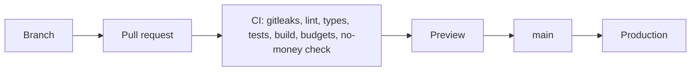
- **CI/CD:** `quality` (gitleaks, lint, typecheck, vitest with coverage, build, budgets, audit, `scripts/no-money-check.mjs` that fails on price, cost, sales, pay or tip-amount fields in `convex/schema.ts` and `schemas/`), `convex` (codegen, tests, deploy on `main`), `e2e` on PRs (Pixel 7, iPhone SE, desktop 1440; axe; Lighthouse). Under 10 minutes. Production by merging to `main`; releases that change a staff flow need the owner's OK; no deploys during dinner service except P1 fixes.
- **Configuration:** `vercel.json` with OSCURA's build script, `next.config.ts` (headers, CSP, Convex storage images), `convex/crons.ts`, `convex/http.ts`.
- **Secrets:** `.env.example` with comments; rotation steps in the runbook.
- **Domains:** `app.thefirsthg.com` `(to be validated)`, HTTPS, HSTS preload after a month.
- **Observability:** Sentry with scrubbing, Convex logs, uptime check on `/api/health` every minute `(to be validated)`.
- **SLO:** 99.5 % monthly in service hours (11:00–02:00 NY). P1: nobody in a venue can see the schedule or tick side work (response in 15 min). Fallback: the weekly schedule and the side-work checklists exported to PDF and kept in each venue office.
- **Disaster recovery:** RPO 24 h, RTO 4 h; the runbook covers restore, rollback and VAPID key loss.
- **Monthly costs `(to be validated)`:** Vercel Pro 20, Convex Professional 25, Sentry Team 26, Resend 0–20, uptime 0–20; about USD 70–110 per month, alert at 150.

## 10. Security
- **Threats specific here:** staff contacting each other through the app (there is no feature for it, by design, ADR 0026); a staff member reading someone else's warnings or schedule notes; a manager editing a published schedule without notifying; a former employee keeping access; shared phones left signed in; lock-screen previews leaking warnings; guests' faces in task photos; schedule disputes without a record of what was published.
- **Controls:**
  - Venue isolation (`requireVenue`) and the layer matrix (`requireCan`) in every function, tested position × function × venue.
  - Published schedules are versioned; a change creates a new version and notifies the people affected; nothing published is overwritten silently.
  - Swaps, open shifts and time off need manager approval and are audited.
  - Deactivation ends every session; idle sign-out after 12 h on staff positions `(to be validated)`.
  - Notifications never include warning content.
  - No guests' faces in task photos; managers can delete a photo (audited).
  - No money fields anywhere (CI check, ADR 0018).
  - OSCURA headers: CSP, HSTS, nosniff, `frame-ancestors 'none'`, camera only on photo routes.
- **Labor law (NY), to validate with counsel before go-live:** legal working age, and legal age for alcohol service checked by the manager when enabling bartender, barback or sommelier; warnings as performance records, never deductions; the tip-pool policy in writing with managers excluded from the pool; the side-work limit for tipped staff (2 h or 20 %); schedule records kept as employment records. This blueprint is not legal advice.
- **Dependencies:** `npm audit`, Renovate weekly, lockfile, gitleaks.
- **Audit in the same mutation:** schedule publish and every published change; swap, open-shift and time-off decisions; attendance marks; event changes; promotions and enabled-position changes; warning propose, issue, discard, void and threshold change; rule set publish; menu publish and 86s; shortage resolve; shift open and close; staff create, reset and deactivate; tip policy publish; photo deletion; 7shifts import.

## 11. Development rules
Copied into AGENTS.md / CLAUDE.md:
- Conventional commits; branches `feat/`, `fix/`, `chore/`; PR with preview.
- TypeScript strict.
- Tokens only (`tests/tokens.test.ts`).
- Every string in `messages/en.json` and `messages/es.json`; content as `{en, es}`.
- **No money** (ADR 0018); counts only where this blueprint lists them.
- Every Convex function: validators + Zod, `requireUser`, `requireVenue`, `requireCan`; audited when listed in section 10.
- Pure rules in `lib/domain/`, shared with the preview handlers.
- Loading, empty, error, offline and locked states on every data screen.
- No emojis or em dashes in the UI; Phosphor icons.
- Knowledge graph at the start and end of each session.

## 12. Modules and code map
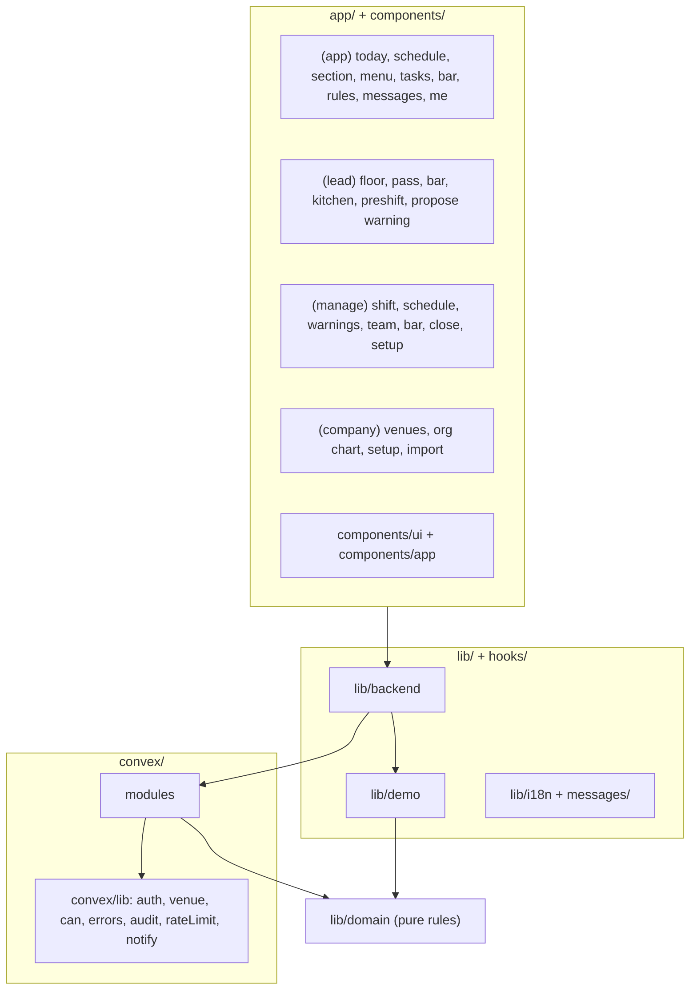

| Module | Layer | Responsibility | Not responsible for |
|---|---|---|---|
| auth | back + front | Sign-in, sessions, passwords | Permissions |
| permissions | shared | Layer × action matrix, venue scope | Identity |
| org | back + front | Areas, positions, chain of supervision, org chart | Hiring |
| states | shared | Venue and person states with reasons (no scores) | Analytics dashboards |
| staff | back + front | Accounts, enabled positions, ladder, promotions | Pay |
| schedule | back + front | Weeks, shifts, events, publish, confirmations, availability, time off, swaps, open shifts, attendance marks | Time clock, payroll |
| shifts | back | Lifecycle and sweep | Schedule |
| floor | back + front | Floor plans, sections, live map, table notes, requests | Reservations, order taking |
| menu | back + front | Items with photos, availability, 86s, confirmations, quiz | Prices, recipes |
| preshift | back + front | Pre-shift notes | Chat |
| tasks | back + front | Side work, progress, side-work load | Scheduling |
| bar | back + front | Shortages, optional counts | Purchasing, costs |
| rules | back + front | Rule sets, versions, confirmations | Warnings |
| warnings | back + front | Propose, issue, acknowledge, void, state | Discipline decisions, pay |
| messages | back + front | One-way announcements with receipts | Conversations |
| close | back + front | Manager log and close | Sales |
| reports | back + front | Team and owner views (no money) | Finance |
| tips | back + front | Written policy and points table (P3) | Amounts |
| import | back | 7shifts CSV migration | Ongoing sync |
| notify | back | Push and email delivery | Content |
| files | back | Uploads and access | - |
| guide | front | How-to per screen, training per position | Courses |

## 13. Internal components
- `components/schedule/` → `MyWeek`, `ShiftCard`, `EventBlock`, `AckBanner`, `SwapSheet`, `OpenShifts`, `AvailabilityGrid`, `TimeOffForm`, `WeekGrid`, `PublishBar`, `ConfirmationsList`, `HoursAlert`
- `components/floor/` → `FloorPlan`, `SectionCard`, `LiveMap`, `TableNotes`, `PassView`, `RequestButton`, `RequestSheet`, `RequestQueue`
- `components/menu/` → `MenuSearch`, `CategoryTabs`, `MenuCard`, `MenuDetail`, `AllergenChips`, `EightySixBadge`, `MenuAckCard`, `Quiz`
- `components/tasks/` → `ChecklistScreen`, `ChecklistRow`, `PhotoField`, `SideWorkMeter`
- `components/bar/` → `ShortageList`, `ShortageRow`, `ShortageBoard`
- `components/warnings/` → `ProposeForm`, `IssueQueue`, `WarningCard`, `StatusChip`, `MyRecord`
- `components/manage/` → `ShiftControl`, `LiveProgress`, `TeamBoard`, `PersonDetail`, `LadderView`, `CloseForm`, `CloseSummary`, `Setup*`
- `components/owner/` → `VenueGrid`, `VenueCard`, `VenueDetail`, `ThresholdsForm`, `TipPolicyForm`, `ImportWizard`, `AuditTable`
- `components/app/` (from OSCURA) → `RequireAuth`, `RequireCan`, `BottomNav`, `LangToggle`, `LargeTextToggle`, `OfflineBanner`, `PwaRoot`, `InstallCard`, `PushPrompt`, `RouteError`, `AppToaster`, `PreviewDevBar`
- `convex/lib/` → `auth.ts`, `venue.ts`, `can.ts`, `errors.ts`, `audit.ts`, `rateLimit.ts`, `notify.ts`

## 14. Functions and objects (pure domain, `lib/domain/`)
- `areas.ts`: `AREAS = [floor, reception, pass, bar, kitchen, venue_management, corporate]`, `areaOf(position)`
- `chain.ts`: `leadOf(position, venue)`, `escalationTarget(item)`, `recipientsFor(kind, section, area)`
- `states.ts`: `personState(...)`, `venueState({close, confirmations, sideWork, shortages, reviews}) → {state: on_track | needs_attention | action_required, reasons[]}`
- `positions.ts`: `POSITIONS` (incl. kitchen and management), `LAYERS`, `layerOf(position)`, `LADDERS = {floor, bar, kitchen, management}`, `nextOnLadder(position)`, `canWork(user, position)`
- `permissions.ts`: `can(layer, action)`, `canSeeVenue(user, venueId)`, `canSeeWarningsOf(actor, target)`
- `schedule.ts`: `weekOf(date)`, `isDouble(shifts)`, `changedPeople(prevVersion, nextVersion)`, `needsConfirm(user, week, acks)`, `swapProblem(a, b, users)`, `openShiftEligible(user, shift)`, `weeklyHours(shifts)`, `overHours(shifts, threshold)`, `eventCoverage(event, shifts) → [{position, required, filled}]`
- `sideWork.ts`: `nonTippedMinutes(templates, shift)`, `overSideWorkLimit(minutes, shiftMinutes)` (more than 120 minutes or 20 %)
- `menu.ts`: `pendingAcks(items, acks)`, `is86(item, shift86s)`
- `floor.ts`: `seatLabel(table, seat)`, `sectionOf(table, plan)`, `whoIsWhere(assignments, users)`
- `requests.ts`: `routeRequest`, `transition`, `escalationDue` (90 s)
- `warnings.ts`: `warningState`, `countable`, `canVoid`, `streak`
- `tasks.ts`: `appliesOn(template, date, service)`, `buildRun`, `runProgress`, `isLate`
- `shift.ts`, `close.ts` (`closeSummary` without money), `rules.ts`, `messages.ts`, `tips.ts` (`policyProblem` rejects managers in the pool), `i18n.ts`, `password.ts`, `session.ts`, `time.ts`
- `types.ts`: `Position`, `Layer`, `Phase`, `Severity`, `ShiftStatus`, `WarningState`, `ShortageLevel`, `RequestKind`, `EventKind`, `Localized = {en: string, es: string}`

Shared Zod schemas: `shiftInput`, `eventInput`, `swapInput`, `timeOffInput`, `availabilityInput`, `floorPlanInput`, `tableNoteInput`, `menuItemInput` (no price), `eightySixInput`, `shortageInput`, `taskTemplateInput`, `ruleSetInput`, `proposalInput`, `warningInput`, `messageInput`, `closeInput` (no money), `tipPolicyInput` (no amounts), `staffInput`, `prefsInput`.

## 15. Quality gates
| Layer | Check | Threshold | Tool |
|---|---|---|---|
| All | Typecheck, lint, gitleaks, audit | 0 errors, no high | CI |
| All | No money | `no-money-check` passes on schema and schemas | CI |
| Front | States, not scores | e2e scan of every staff route: no `$`, no `%`, no score labels | Playwright |
| Back | No peer to peer | no function lets a staff account address another staff account directly | convex-test |
| Domain | Unit tests | ≥ 90 % lines, functions, statements on `lib/domain/**`; every function in section 14 tested | Vitest |
| Back | Functions | every exported function tested; position × function × venue matrix passes | convex-test |
| Back | Concurrency | two people claiming one open shift, double swap approval, publish while editing, two people ticking one run, double close | convex-test |
| Back | Schedule | publishing notifies everyone scheduled; a change after publishing notifies only the people affected; reminder at 24 h | convex-test |
| Front | Copy and tokens | identical keys; no literals | tests |
| Front | e2e | staff day, publish and confirm a week, swap, event staffing, propose and issue a warning, shortage reported and restocked, close, venue and company states; Pixel 7, iPhone SE, desktop; EN and ES; Large text | Playwright |
| Front | Accessibility | axe 0 serious or critical; Lighthouse a11y 100 on `/`, `/login`, `/today` | axe, Lighthouse |
| Front | Performance | budgets in 6.6 | measure-budgets, Lighthouse |
| Front | Usability | 5 staff aged 18–65 complete their tasks without help; warning form p95 < 30 s; a busser finds section, rules, schedule and warnings in under 10 s each | manual |
| DevOps | Recovery | restore drill timed | runbook |
| Motion | Not applicable | | |

## 16. Development plan (tracks)
One-week sprints `(to be validated)`. Pilot in one venue after Sprint 2.

### 16.1 Epics
1. Platform base. 2. People and positions (ladder, enabled positions). 3. Schedule and events (7shifts parity). 4. Menu, 86s and confirmations. 5. Floor: plans, sections, table notes, requests, pre-shift. 6. Side work. 7. Bar shortages. 8. Rules, warnings and performance. 9. Manager close, venue and company states. 10. Kitchen area and the org chart. 11. P3: reservations link, tip policy, bar counts, quiz, import improvements.

### 16.2 Sprints
| Sprint | Front | Back | DevOps | Demo |
|---|---|---|---|---|
| 0 | Shell from OSCURA re-tokened with the martini palette and the lion, `components/ui`, BottomNav per position, `/login`, `/me` | Schema (org, areas, users, positions, assignments, history, chain), auth bridge, `requireVenue`, `requireCan`, matrix, seed | Repo, CI with the no-money check, Vercel + Convex, preview mode, Sentry | A manager and a busser of Venue 1 sign in; each sees only their tabs |
| 1 | Schedule (MyWeek, WeekGrid, events, publish, confirm), menu with photos, rules | schedule (weeks, shifts, events, publish, confirm, remind), menu (items, availability, confirmations), rules, notify | VAPID, push on the installed iOS PWA | The owner creates a private dinner; the manager staffs it and publishes; everyone gets the push and confirms; the manager sees who did not |
| 2 | Today, floor plan and sections, live map, pass view, pre-shift and 86s, side work, requests, bar shortages, close, venue and company states | shifts, floor, preshift, menu 86s, tasks, requests, bar, close, states, reports.venueState and company, sweep | Uptime check, backup and restore drill | A full dinner in preview. **Pilot starts in Venue 1** |
| 3 | Propose and issue warnings, my record, team board, swaps, open shifts, availability, time off, attendance marks, hours and side-work alerts | warnings, schedule extras, sideWork, reports.team | Load test 300 staff, audit review | A captain proposes, the manager issues in under 30 s, the server confirms; a swap approved end to end |
| 4 | Kitchen area (station side work, 86s from the line, sous chef proposals), org chart, guide and training per position, ladders and promotions, menu quiz, 7shifts import wizard | org.chart, staff.promote, quiz, import, kitchen templates | Restore drill #2 | **Rollout to the 4 venues** with people imported from 7shifts |
| 5 (P3) | Tip policy screen, reservations link per venue, optional bar counts | tips, barCounts | Counsel review | Tipped staff confirm the written tip policy |

### 16.3 Definition of Done
Section 15 gates green with numbers in `docs/DEVLOG.md`; pilot metrics measured at day 14; owner sign-off on schedule, warnings and close; counsel note on warnings, schedule records and tip policy.

### 16.4 Risks
| Risk | Mitigation |
|---|---|
| The schedule is a big module and competes with 7shifts | Parity only on what TFHG uses (blocking question 4); import from 7shifts; scheduling first because it is the owner's first problem |
| Staff do not install the PWA, so push never arrives on iOS | Install card at first sign-in; line-up walkthrough; in-app confirmations are the record |
| Content load (menu photos, floor plans, rules for 4 venues) | Venue 1 first; templates copied across venues; the implementation fee covers loading |
| Warnings feel punitive | Rule-linked, private, with response, 30-day window, recognition |
| Legal exposure (warnings, schedule records, side work, tip pool) | Counsel before the pilot; no money stored |
| Managers skip the close | Sweep and the owner's "close missing" card |
| Scope creep into payroll, POS or reservations | Out of scope (section 1, ADR 0018) |

## 17. Commercial package
Proposal in `docs/PROPUESTA-COMERCIAL.md` (Spanish): implementation fee plus a monthly license per venue, anchored on what 7shifts plus separate apps cost (≈ USD 205 per venue per month, `docs/research/ESTUDIO-DE-MERCADO.md`). Amounts `(to be validated)`. Acceptance criteria = section 15. Not included: hardware, POS and reservations integrations (P3 quote), menu photography.

## 18. Amendment log
- **2026-10-18 (cross-shift actions, ADR 0032):** Durable operational follow-up extends sections 2.3, 3.4, 6.1, 7.2, 8.1, 8.4 and 10. Managers/corporate assign one active named subordinate in the configured venue chain, bilingual instructions and a New York due date/time. `/actions`, `/actions/new` and `/actions/[id]` serve own work and authorized supervision (170 KB route budget, client data, existing error boundary/loading/offline/empty/locked primitives). `actions.list` and `actions.history` paginate; `actions.get`, `actions.assignees`, `actions.create`, `actions.transition` and internal `actions.sweep` run registered handlers in browser preview. Additive `operatingActions` and append-only `operatingActionEvents` retain revisioned evidence; no destructive migration. Optional close provenance is a submitted report item index plus immutable text snapshot, unique per source. It never changes the closed shift. Assignees start and submit evidence; a manager above them returns or verifies; reassignment and cancellation require reasons; verified/canceled are read-only. Every write is audited. Hourly bounded escalation marks overdue and notifies the first available superior, director at +24 h and owner at +48 h, idempotently. Today, manager shortcuts, close reports and company venue detail link to actions; overdue actions give a venue Action required reason. No peer chat, self verification, scores, money or automated discipline. Pending retention validation is required before production.
- **2026-10-18 (role playbooks and supervised training, ADR 0031):** Sections 2.5, 6, 7.2, 8.1 and 8.4 define 22 production role playbooks, 21 supervised programs, immutable bilingual program versions, private evidence and authorized human review through the configured chain. Three additive tables and seven registered handlers run locally without destructive reseeding or remote migration. Browser preview mutations retain the initiating identity, use a cross-tab transaction lock where available, and order inserts deterministically. The capability audit preserves the remaining full operating objective.
- **2026-10-18 (preview access, didactic screens and original logo, ADR 0030):** Tab-local preview identities preserve shared sample records without cross-tab session replacement or storage feedback. Query results and errors are scoped to identity. Contextual EN/ES instructions explain the next action on operational screens; unavailable menu items explain the term 86. The owner commissions a new vector lion from scratch, replacing the neutral placeholder decisions below. Service acknowledgments appear without a fading transition to retain full text contrast.
- **2026-10-18 (burgundy primary identity, ADR 0029):** The owner replaces martini green with burgundy. Section 4.1, the shared tokens, brand documentation, application controls and generated install icons follow the new palette. The final lion remains pending; delivery uses the single replaceable neutral mark. The host's existing Pre-shift tab reads notes without permission to publish or remove them, consistent with sections 2.4 and 6.1.1.
- **2026-10-17 (frontend preview scope and brand delivery):** At the owner's request, this session works on the frontend and browser Convex mock only; no remote Convex or production deployment. The attached build blueprint section 0.7 supersedes the current lion drawing for delivery: use the THE FIRST wordmark and a neutral placeholder from `public/brand/mark.svg` until the final SVG is supplied. Existing lion artwork remains reference material. Browser mock mutations are serialized to preserve concurrent UI changes; failures roll back without blocking later saves.
  - Windows verification may use `npm run build:webpack` when Turbopack cannot start its loader subprocesses; the official Tailwind PostCSS adapter preserves the same token styles. Turbopack remains the default. `npm run gen:brand` derives the favicon and install PNGs from the single mark asset and brand tokens. Schedule and shared confirmation controls are read-only while offline; the persisted preview data remains readable after reload.
  - The mock supplies an empty browser-only environment for server-handler flags; no server environment values are injected. Fonts are served from `public/fonts` with absolute URLs so inline CSS works with both bundlers. The delivery wordmark uses Figtree SemiBold with the 0.16 em token specified by the attached build blueprint.
- **2026-10-13 (v1.3 applied to the built code):** The v1.1 build (Sprints 0 to 5) is migrated to this v1.3. Carried over from the v1.1 build amendments, still valid: (1) preview mode runs the real Convex handlers over an in-browser database, and the same engine is the backend test harness; that ADR, written as 0018 during the build, is renumbered **ADR 0028** because v1.3 assigns 0018 to "no money"; project rule 19 now points to it instead of `lib/demo/handlers.ts`. (2) UI copy is split by namespace, `messages/<locale>/<namespace>.json`, merged in `messages/index.ts`; identical keys per locale, tested. (3) `users.mustChangePassword` blocks every function except `auth.me`, `me.updatePrefs` and the password bridge (`PASSWORD_CHANGE_REQUIRED`). (4) Analytics events are stored in `analyticsEvents`; schedule events in `venueEvents` (section 8.1 names `events`). (5) Staff sessions end after 12 h, leaders and above after 7 days. Dropped with v1.3: the bar stock ledger and its shortage semantics, pay, void and comp approvals, levels A/B/C.
  - **Implementation decisions (2026-10-13, v1.3 build):** (a) Layers in code are `support, service, lead, manager, corporate` (`manager` = venue management); the chef de cuisine is manager layer for the kitchen and menu but does not open shifts or file the close (`NOT_FOR` in `permissions.ts`). (b) The working position comes from the person's first planned shift of the day; managers and corporate keep their primary position; a covered lower shift never removes a manager's own permissions (`actorCan`). (c) Schedule weeks start on Monday `(to be validated against TFHG's 7shifts setup)`. (d) The 7shifts import is the module `imports` (`import` cannot name a module in the generated API) and is a mutation that receives the CSV text, not an action behind a route handler; temporary passwords are shown once and only their hashes are stored. (e) Approving a swap republishes the week: only the people affected are notified, but other pending edits of that week go out with it. (f) The venue state counts a close as missing when a shift is still open 4 h after its end (the sweep's notify point); a service that was never opened is not counted. (g) Pre-shift notes have no archive field: they stop showing when the shift closes and stay in the record. (h) Optional bar counts in tenths (P3) are not built yet; the shortage list covers ADR 0023. (i) Rule sets: one company set for everyone plus one set per position (venue copies allowed); a person confirms the company set, their venue set and the sets of every position they may work.
- **2026-10-13 (v1.3, executive direction and the full organization):**
  - **Executive hospitality brand** (ADR 0025): martini green `#4A6B3E` replaces olive; the lion in profile replaces the TFHG monogram; light by default; no nightlife language or imagery. Section 4 rewritten.
  - **Organization by area** (ADR 0020 amended): seven areas (floor, reception, pass, bar and wine, kitchen, venue management, corporate), positions from polisher and dishwasher to director of operations, four ladders, what each role does and needs (2.1, 2.2, 2.5).
  - **Chain of supervision and mediation** (ADR 0026): instructions down, reports up, escalations, no peer-to-peer contact; swaps go through the manager; leads (captain, maître d', head bartender, sous chef) propose warnings; proposals escalate to the GM after 24 h.
  - **States, not scores** (ADR 0027): no money and no performance numbers on staff screens; venue states On track / Needs attention / Action required with reasons for GM, director and owner.
  - **Flows:** the operating cycle (3.1), a service by area (3.2) and the journey of every role (3.7).
  - Routes regrouped (`(company)` for director and owner), tabs for every position, contracts, data, domain, gates and sprints updated.
- **2026-10-13 (v1.2, owner's notes and NY roles research):**
  - **No money** (ADR 0018): removed prices from staff screens, sales, comps and voids from the close, void and comp requests, pay records and adjustments, and bar costs. Supersedes the money parts of ADR 0008 and 0013, and ADR 0017.
  - **The schedule is the core** (ADR 0019): weeks, shifts, doubles, events with required positions, publish with confirmation, availability, time off, swaps, open shifts, attendance marks, hours and side-work alerts, 7shifts import. Moved to Sprint 1. Supersedes the scheduling part of ADR 0011.
  - **Ten positions in four layers with a career ladder** (ADR 0020): added polisher, expo, host / maître d' and optional sommelier; primary and enabled positions; promotions with history; access by layer. Kitchen out of v1 except through the expo. Captains propose warnings, managers issue them. Levels A, B, C removed (read as list numbering in the owner's notes); supersedes ADR 0014 and amends ADR 0003.
  - **Floor plan, 86s and pre-shift** (ADR 0021); **schedule and menu confirmations** with an optional menu quiz (ADR 0022); **bar shortage list** instead of counts (ADR 0023); **tip policy as configuration only**, P3 (ADR 0024).
  - Requests reduced to water, clear and help; table allergy notes go to the expo instead of a kitchen board.
  - Document rewritten; sections 1 to 17 updated. Owner questions in `docs/PREGUNTAS-DUENO.md`; research in `docs/research/JERARQUIA-ROLES-NY.md`.
- **2026-10-13 (v1.1, from the owner's system map):** floor requests and help, void and comp approvals, table notes, sections, levels A/B/C, weekly recurring tasks, pay records with approval. ADR 0013 to 0017. ER label fix.
- **2026-10-13:** Blueprint created on the OSCURA NYC technical base. ADR 0001 to 0012.
